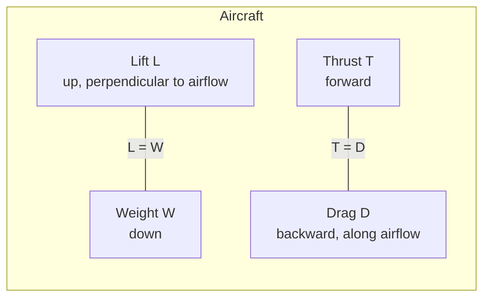

# Aerodynamics Basics

> **TL;DR** — A wing deflects air downward, producing lift as the reaction, and pays for it with drag. Lift and drag scale with dynamic pressure times wing area times a coefficient, and the ratio of the two (L/D) sets how efficiently an aircraft flies.

## Why it matters

Aerodynamic forces size wings, set cruise speed and fuel burn, determine stall behavior and govern re-entry and launch ascent. The coefficient-based formulation lets you scale wind-tunnel and simulation data to real vehicles.

## Core ideas

### Force coefficients

With air density $\rho$, speed $v$ and reference (wing) area $S$:

$$
q = \tfrac12\rho v^2, \qquad L = q S C_L, \qquad D = q S C_D
$$

At sea level in the International Standard Atmosphere, $\rho = 1.225\ \text{kg/m}^3$. Density falls with altitude, so at the same speed a plane generates less lift when high and hot ("density altitude").

### Dimensionless numbers

| Number | Definition | Meaning |
|---|---|---|
| Reynolds | $Re = \rho v \ell/\mu$ | Ratio of inertial to viscous forces; governs boundary-layer behavior and whether scale models are representative |
| Mach | $M = v/a$, with $a=\sqrt{\gamma R T}$ | Compressibility; $a \approx 340$ m/s at 15 °C; effects matter above about $M \approx 0.3$ and shocks appear near and above $M \approx 0.8$ |

### Drag polar

Total drag splits into zero-lift (parasite) drag and induced drag from generating lift:

$$
C_D = C_{D0} + k\,C_L^2, \qquad k = \frac{1}{\pi\, e\, AR}
$$

where $AR = b^2/S$ is the wing's aspect ratio (span squared over area) and $e \le 1$ is the span-efficiency factor. Long, slender wings have low induced drag, which is why gliders look the way they do.

The best lift-to-drag ratio occurs where induced and parasite drag are equal ($C_{D0} = kC_L^2$):

$$
\left(\frac{L}{D}\right)_{max} = \frac{1}{2\sqrt{k\,C_{D0}}}
$$

### Stall

Lift coefficient rises roughly linearly with angle of attack until the boundary layer separates from the upper surface, after which lift drops sharply. With maximum lift coefficient $C_{L,max}$ the stall speed in level flight is

$$
V_s = \sqrt{\frac{2W}{\rho S C_{L,max}}}
$$

### What actually produces lift?

Pressure is lower on the upper surface and higher on the lower, and the net force equals the rate at which the wing gives downward momentum to the air (Newton's second and third laws). Bernoulli's equation, $p + \tfrac12\rho v^2 + \rho g h = \text{const}$ along a streamline in steady, incompressible, inviscid flow, is a valid link between the velocity field and the pressure field. The popular "equal transit time" explanation is wrong: air over the top does not need to meet air from below at the trailing edge, and it actually arrives sooner.

## Diagram

Forces in steady, level flight:

## Worked example

A light aircraft: weight $W = 10{,}000$ N, wing area $S = 16\ \text{m}^2$, aspect ratio 8, $e = 0.8$, $C_{D0} = 0.03$, cruising at 40 m/s at sea level.

1. Dynamic pressure: $q = \tfrac12(1.225)(40)^2 = 980$ Pa.
2. Level flight needs $L = W$: $C_L = W/(qS) = 10000/(980\times16) \approx 0.64$.
3. Induced-drag factor: $k = 1/(\pi\times0.8\times8) \approx 0.0497$.
4. $C_D = 0.03 + 0.0497\times0.64^2 \approx 0.050$.
5. Drag: $D = qSC_D \approx 980\times16\times0.050 \approx 790$ N, so the engine must deliver about 790 N of thrust, i.e. about $790\times40 = 31.5$ kW of useful power.
6. $L/D = 0.64/0.050 \approx 12.7$, close to the maximum $1/(2\sqrt{0.0497\times0.03}) \approx 12.9$ (achieved near $C_L \approx 0.78$, a little slower than 40 m/s).
7. Stall speed with $C_{L,max} = 1.5$: $V_s = \sqrt{2\times10000/(1.225\times16\times1.5)} \approx 26$ m/s.

## Pitfalls

- **Using sea-level density at altitude** or ignoring temperature.
- **Treating $C_L$ and $C_D$ as constants:** they depend on angle of attack, Reynolds number and Mach number.
- **Believing the equal-transit-time story** for lift.
- **Applying incompressible formulas at high Mach numbers**, where density changes and shocks change everything.
- **Forgetting induced drag grows as $v^{-2}$ at fixed weight** while parasite drag grows as $v^2$, so there is a minimum-drag speed and flying slower than it requires *more* thrust (the "back side of the power curve").

## Related

- [Classical mechanics](../physics/classical-mechanics.md) — momentum and force balance.
- [Thermodynamics](../physics/thermodynamics.md) — compressibility and heating at high speed.
- [PID control](../control-systems/pid-control.md) — autopilot loops built on these force models.
- [Calculus & optimization](../mathematics/calculus-and-optimization.md) — finding the best-L/D condition is a one-line optimization.

## Further reading

- Anderson, *Introduction to Flight* and *Fundamentals of Aerodynamics*.
- Abbott & von Doenhoff, *Theory of Wing Sections* — airfoil data.
