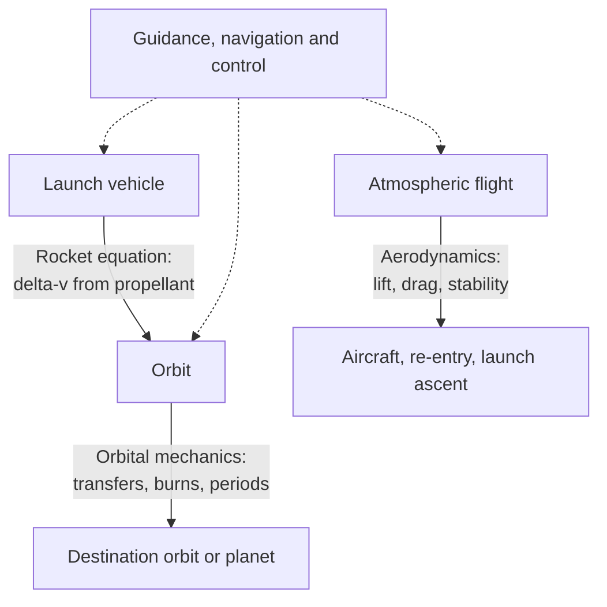

# Aerospace

> **Scope** — The engineering of vehicles that fly in air and space: how orbits work, how rockets trade propellant for velocity, and how wings generate lift at the cost of drag.

## Visual summary

## Notes

| Note | Status | One-line summary |
|---|---|---|
| [Orbital mechanics](orbital-mechanics.md) | growing | Vis-viva, Kepler, Hohmann transfers, with LEO-to-GEO numbers |
| [Rocket equation & staging](rocket-equation-and-staging.md) | growing | Why delta-v is logarithmic in mass ratio and why rockets have stages |
| [Aerodynamics basics](aerodynamics-basics.md) | growing | Lift, drag, the drag polar, stall and what actually produces lift |

## Suggested reading order

Rocket equation → Orbital mechanics (the two together define a mission's delta-v budget) → Aerodynamics for atmospheric flight.

## Related topics

- [Physics](../physics/index.md) — classical mechanics and thermodynamics underneath.
- [Control systems](../control-systems/index.md) — attitude control, autopilots, guidance.
- [Mathematics](../mathematics/index.md) — calculus, linear algebra and numerical methods.
- [Robotics](../robotics/index.md) — shared estimation and control ideas.
