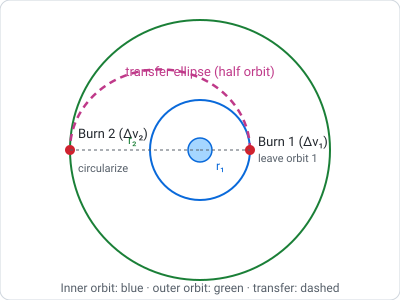
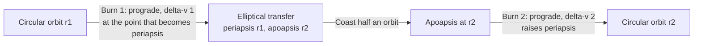

# Orbital Mechanics

> **TL;DR** — An orbit is continuous free-fall around a body. Speed and altitude are tied together by energy conservation (the vis-viva equation), so changing orbit means changing velocity, and the cheapest two-burn way between circular orbits is the Hohmann transfer.

## Why it matters

Every mission plan starts with a velocity budget. Orbital mechanics converts "where do I want to be" into "how much delta-v must I buy," which sizes the propellant via the [rocket equation](rocket-equation-and-staging.md).

## Core ideas

### Kepler's laws (consequences of Newtonian gravity)

1. Orbits are conic sections (for bound orbits, ellipses) with the central body at one focus.
2. A line from the body to the satellite sweeps equal areas in equal times (conservation of angular momentum), so the satellite moves fastest at periapsis.
3. Orbital period depends on the semi-major axis: $T = 2\pi\sqrt{a^3/\mu}$.

Here $\mu = GM$ is the gravitational parameter; for Earth, $\mu \approx 3.986\times10^{5}\ \text{km}^3/\text{s}^2$.

### Energy and the vis-viva equation

$$
v^2 = \mu\left(\frac{2}{r} - \frac{1}{a}\right)
$$

- Circular orbit ($a = r$): $v_c = \sqrt{\mu/r}$
- Escape from radius $r$: $v_{esc} = \sqrt{2\mu/r} = \sqrt{2}\,v_c$

Surprising consequence: burning prograde raises the *opposite* side of the orbit, and a higher circular orbit is slower than a lower one.

### Orbital elements

| Element | Symbol | Meaning |
|---|---|---|
| Semi-major axis | $a$ | Size (sets period and energy) |
| Eccentricity | $e$ | Shape; 0 is circular, below 1 is elliptical |
| Inclination | $i$ | Tilt of the orbit plane relative to the equator |
| Right ascension of ascending node | $\Omega$ | Where the orbit crosses the equator going north |
| Argument of periapsis | $\omega$ | Orientation of the ellipse within its plane |
| True anomaly | $\nu$ | Where the satellite is along the orbit right now |

### The Hohmann transfer

Between coplanar circular orbits of radii $r_1 < r_2$, use two tangential burns:

$$
\Delta v_1 = \sqrt{\frac{\mu}{r_1}}\left(\sqrt{\frac{2r_2}{r_1+r_2}} - 1\right), \qquad
\Delta v_2 = \sqrt{\frac{\mu}{r_2}}\left(1 - \sqrt{\frac{2r_1}{r_1+r_2}}\right)
$$

The transfer ellipse has semi-major axis $a_t = (r_1 + r_2)/2$ and takes half its period: $t = \pi\sqrt{a_t^3/\mu}$. It is the minimum-delta-v two-impulse transfer between coplanar circular orbits; three-impulse bi-elliptic transfers can win when $r_2/r_1$ exceeds about 11.9, at the cost of much longer flight time.

## Diagram

## Worked example: low Earth orbit to geostationary orbit

Start in a 300 km circular orbit ($r_1 = 6378 + 300 = 6678$ km) and target GEO ($r_2 = 42164$ km), ignoring plane change.

- Circular speed at LEO: $\sqrt{\mu/r_1} = 7.726$ km/s (period about 90.5 minutes).
- $\Delta v_1 = 2.426$ km/s
- $\Delta v_2 = 1.467$ km/s
- **Total $\approx 3.89$ km/s**, transfer time $\approx 5.3$ hours
- GEO period check: $T = 2\pi\sqrt{r_2^3/\mu} \approx 23.93$ h, one sidereal day, which is why that orbit stays over one longitude.

**Plane change:** launching from 28.5° latitude leaves the LEO inclined 28.5° to the equator. Removing it during the apoapsis burn (where speed is lowest and plane changes are cheapest) raises the second burn to about 1.83 km/s instead of 1.47 km/s, so the total becomes roughly 4.26 km/s.

## Pitfalls

- **Intuition from driving:** to catch a target ahead of you in the same orbit, you do not accelerate toward it; speeding up raises your orbit and slows your angular progress. Rendezvous requires phasing.
- **Mixing units:** $\mu$ in km³/s² with $r$ in km yields km/s; do not mix with metres.
- **Radius vs altitude:** use distance from the body's *center*, not altitude above the surface.
- **Impulsive-burn assumption:** valid for chemical rockets with short burns; low-thrust electric propulsion needs spiral-transfer analysis and different delta-v numbers.
- **Perturbations:** atmospheric drag, Earth's oblateness ($J_2$), third-body gravity and solar radiation pressure make real orbits drift from ideal Keplerian ellipses.

## Related

- [Rocket equation & staging](rocket-equation-and-staging.md) — turning delta-v into propellant mass.
- [Classical mechanics](../physics/classical-mechanics.md) — conservation of energy and angular momentum.
- [Linear algebra](../mathematics/linear-algebra.md) — rotations between orbital and inertial frames.
- [State estimation](../robotics/state-estimation.md) — orbit determination is a filtering problem.

## Further reading

- Curtis, *Orbital Mechanics for Engineering Students*.
- Vallado, *Fundamentals of Astrodynamics and Applications*.
