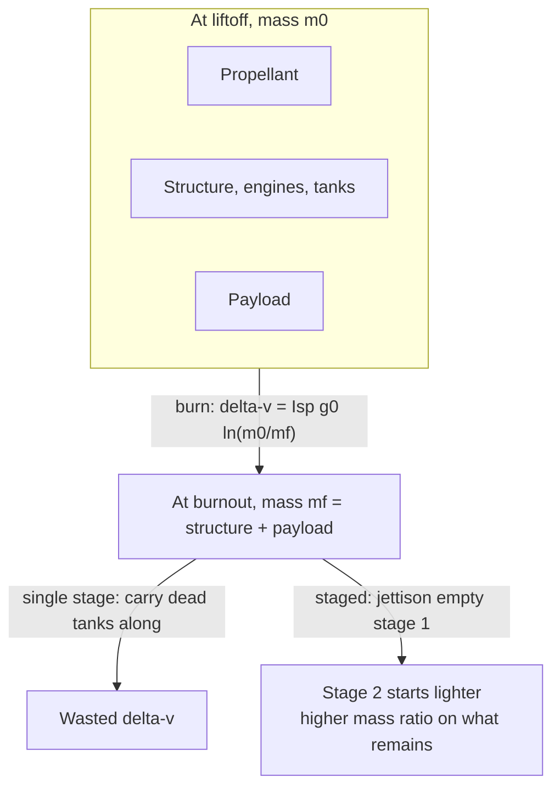

# The Rocket Equation and Staging

> **TL;DR** — A rocket's velocity change grows only with the *logarithm* of its mass ratio, so each extra bit of delta-v demands exponentially more propellant. Staging, discarding empty structure along the way, is how rockets escape that tyranny.

## Why it matters

The rocket equation explains why launch vehicles are mostly propellant, why payload fractions are a few percent, and why efficient engines (high specific impulse) are worth so much. It is the first calculation in any mission design.

## Core ideas

### The Tsiolkovsky equation

$$
\Delta v = v_e \ln\frac{m_0}{m_f} = I_{sp}\, g_0 \ln\frac{m_0}{m_f}
$$

- $m_0$: initial (wet) mass; $m_f$: final (dry) mass; the ratio $m_0/m_f$ is the **mass ratio**.
- $v_e$: effective exhaust velocity.
- $I_{sp}$: specific impulse in **seconds** $= F/(\dot m\, g_0)$, with $g_0 = 9.80665\ \text{m/s}^2$ by definition. Higher is more propellant-efficient.

Inverting for the propellant needed:

$$
\frac{m_{prop}}{m_0} = 1 - e^{-\Delta v / v_e}
$$

### Typical specific impulse

| Propulsion type | Approximate $I_{sp}$ (vacuum) |
|---|---|
| Solid motors | 250 to 290 s |
| Kerosene / liquid oxygen | 300 to 350 s |
| Liquid hydrogen / liquid oxygen | 420 to 465 s |
| Electric (ion, Hall thrusters) | 1,500 s to several thousand s (but very low thrust) |

Thrust and $I_{sp}$ are different things: electric thrusters are efficient but cannot lift a rocket off the ground.

### Staging

Dropping empty tanks and engines stops you from accelerating dead weight. For each stage with structural fraction $\varepsilon = m_{structure}/(m_{structure} + m_{propellant})$ carrying payload $P$ above it, the stage mass needed to deliver mass ratio $R$ is

$$
M = P\,\frac{R - 1}{1 - R\varepsilon}
$$

which is only possible if $R\varepsilon < 1$. That inequality is the hard limit that makes staging necessary.

## Diagram

## Worked examples

**Single burn.** $I_{sp} = 350$ s ($v_e \approx 3432$ m/s), mass ratio 10: $\Delta v = 3432 \times \ln 10 \approx 7.9$ km/s.

**Propellant for the LEO-to-GEO transfer.** Using the 3.89 km/s from [Orbital mechanics](orbital-mechanics.md) with the same engine: $m_0/m_f = e^{3893/3432} \approx 3.11$, so propellant is $1 - 1/3.11 \approx 68\%$ of the departing mass.

**Why launch vehicles are staged.** Reaching low Earth orbit takes roughly 9.3 to 10 km/s once gravity and drag losses are included. With $I_{sp} = 350$ s, a single stage needs $R = e^{9400/3432} \approx 15.5$, i.e. 93.5% of liftoff mass must be propellant. With a realistic structural fraction $\varepsilon = 0.08$, $R\varepsilon \approx 1.24 > 1$: **it cannot be done, even with zero payload.**

Split the job into two stages of 4.7 km/s each: $R = e^{4700/3432} \approx 3.93$ per stage, $R\varepsilon \approx 0.31 < 1$. Working upward from payload $P$:

| Stage | Mass | Reasoning |
|---|---|---|
| Stage 2 | $4.28\,P$ | $M = P(R-1)/(1-R\varepsilon)$ |
| Stage 1 | $22.6\,P$ | Carries stage 2 plus payload, $5.28\,P$, so $M = 5.28\,P \times 4.28$ |
| Total at liftoff | $27.9\,P$ | Payload is about 3.6% of liftoff mass |

A small payload fraction is not poor engineering; it is what the equation demands.

## Pitfalls

- **Treating $I_{sp}$ in seconds as a speed:** multiply by $g_0$ to get $v_e$ in m/s.
- **Forgetting losses:** the delta-v to orbit is more than orbital speed (about 7.8 km/s) because of gravity losses, drag and steering losses.
- **Assuming delta-v is free to add across vehicles:** the equation applies per burn with the mass *at that moment*; staging means recomputing with the new masses.
- **Ignoring thrust-to-weight:** a high-$I_{sp}$ engine with thrust below the vehicle's weight cannot leave the pad.
- **Optimistic structural fractions:** real values depend on tank materials, pressurization, engines and margins; $\varepsilon$ of 0.05 to 0.15 is typical for chemical stages.

## Related

- [Orbital mechanics](orbital-mechanics.md) — where the delta-v requirement comes from.
- [Thermodynamics](../physics/thermodynamics.md) — a rocket engine is a heat engine converting enthalpy into exhaust velocity.
- [Classical mechanics](../physics/classical-mechanics.md) — momentum conservation derives the equation.
- [Calculus & optimization](../mathematics/calculus-and-optimization.md) — optimal stage splitting is a constrained optimization.

## Further reading

- Sutton & Biblarz, *Rocket Propulsion Elements*.
- Wertz & Larson, *Space Mission Analysis and Design*.
