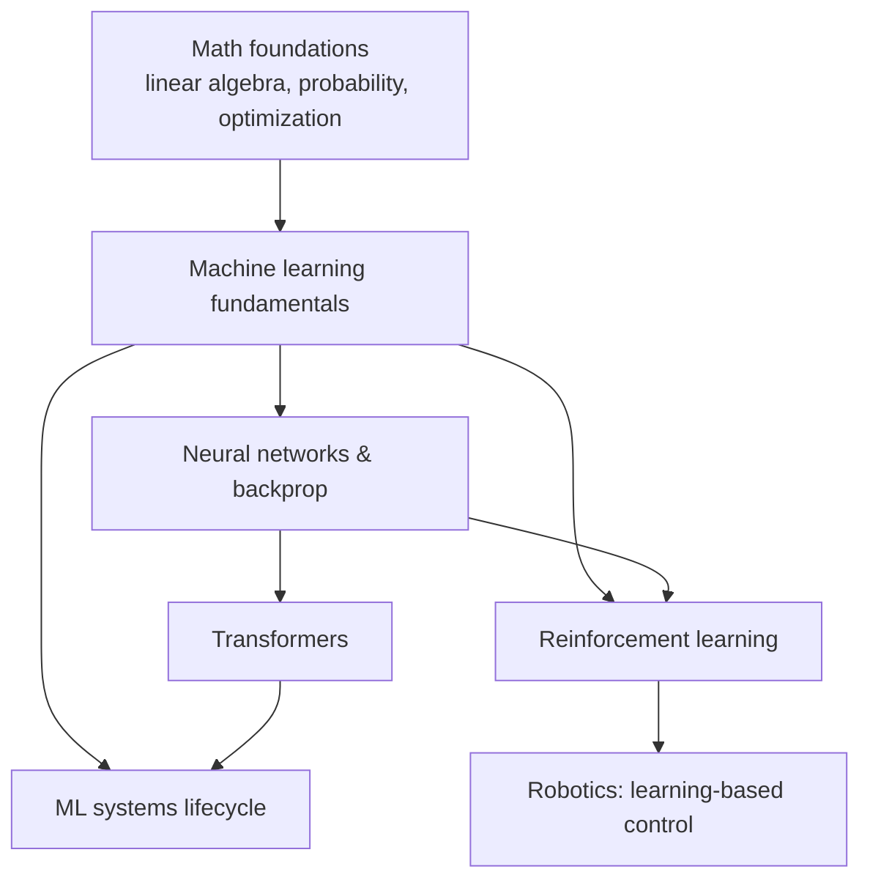

# Artificial Intelligence

> **Scope** — How machines learn functions from data: the statistical foundations, the neural-network machinery, the architectures that dominate today, learning from interaction, and the engineering needed to run all of it reliably.

## Visual summary

## Notes

| Note | Status | One-line summary |
|---|---|---|
| [Machine learning fundamentals](machine-learning-fundamentals.md) | growing | Risk minimization, bias-variance, evaluation, and how to avoid fooling yourself |
| [Neural networks & backprop](neural-networks-and-backprop.md) | growing | Layers, the chain rule, and a 30-line NumPy network that learns XOR-like data |
| [Transformers](transformers.md) | growing | Attention, the transformer block, and why it scales |
| [Reinforcement learning](reinforcement-learning.md) | growing | MDPs, Bellman equations, Q-learning and policy gradients |
| [ML systems lifecycle](ml-systems-lifecycle.md) | growing | From problem framing to monitoring and retraining |

## Suggested reading order

1. [Probability & statistics](../mathematics/probability-and-statistics.md) and [Linear algebra](../mathematics/linear-algebra.md) if the notation feels unfamiliar.
2. Machine learning fundamentals → Neural networks → Transformers.
3. Reinforcement learning, then [Robotics](../robotics/index.md) to see learning meet hardware.
4. ML systems lifecycle once you intend to ship something.

## Related topics

- [Mathematics](../mathematics/index.md) — the language everything above is written in.
- [Robotics](../robotics/index.md) — where learned policies meet physical constraints.
- [Control systems](../control-systems/index.md) — RL and optimal control are two views of the same problem.
