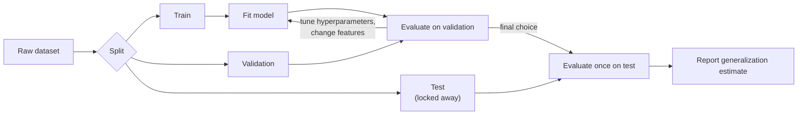

# Machine Learning Fundamentals

> **TL;DR** — Machine learning fits a function to data so that it performs well on *unseen* data. Training error is easy to drive down; the real work is measuring and controlling generalization error honestly.

## Why it matters

Every modern AI system, from a spam filter to a large language model, is an instance of the same recipe: choose a model family, define a loss, optimize on data, and evaluate on data the model never saw. Most failures in practice are not exotic. They come from leakage, a mismatched metric, or a test set that does not look like production.

## Core ideas

### Learning paradigms

| Paradigm | Signal | Typical task | Example |
|---|---|---|---|
| Supervised | Labeled pairs $(x, y)$ | Classification, regression | Predict house price from features |
| Unsupervised | Structure in $x$ only | Clustering, density estimation, dimensionality reduction | Segment customers; PCA |
| Self-supervised | Labels derived from the data itself | Representation learning | Predict the next token; mask and reconstruct |
| Reinforcement | Scalar reward from interaction | Sequential decisions | Game playing, robot control (see [RL](reinforcement-learning.md)) |

### Empirical risk minimization

Pick a model $f_\theta$ and a loss $L$. Minimize the average loss on the training set, plus an optional penalty:

$$
\hat\theta = \arg\min_\theta \; \frac{1}{N}\sum_{i=1}^{N} L\big(f_\theta(x_i),\, y_i\big) \;+\; \lambda\, R(\theta)
$$

What you actually care about is the *expected* loss over the data distribution, which you can only estimate on held-out data.

### Bias-variance trade-off

For squared error with noise variance $\sigma^2$, the expected test error at a point decomposes as:

$$
\mathbb{E}\big[(y - \hat f(x))^2\big] = \underbrace{\text{Bias}[\hat f(x)]^2}_{\text{too simple}} + \underbrace{\text{Var}[\hat f(x)]}_{\text{too sensitive to the sample}} + \underbrace{\sigma^2}_{\text{irreducible}}
$$

- **High bias (underfitting):** training and validation error are both high.
- **High variance (overfitting):** training error is low, validation error is much higher.

> **Modern caveat.** Very large neural networks can interpolate the training set and still generalize ("double descent"). The classical U-shaped curve is a useful default, not a law.

### Controlling overfitting

| Technique | How it helps |
|---|---|
| More (or more diverse) data | Reduces variance directly |
| L2 regularization (weight decay) | Penalizes large weights, smoother functions |
| L1 regularization | Drives weights to exactly zero, sparse models |
| Early stopping | Stop when validation loss stops improving |
| Dropout | Randomly zeroes activations during training |
| Data augmentation | Encodes invariances (flip, crop, noise) |
| Simpler model | Fewer degrees of freedom |

## Diagram

The honest evaluation workflow. The test set is touched **once**, at the very end.

## Key equations and metrics

For binary classification with true/false positives (TP, FP) and negatives (TN, FN):

$$
\text{Precision}=\frac{TP}{TP+FP},\qquad
\text{Recall}=\frac{TP}{TP+FN},\qquad
F_1=\frac{2\,\text{Precision}\cdot\text{Recall}}{\text{Precision}+\text{Recall}}
$$

| Metric | Use when |
|---|---|
| Accuracy | Classes are balanced and errors cost the same |
| Precision | False alarms are expensive (spam to inbox is fine, good mail to spam is not) |
| Recall | Misses are expensive (disease screening) |
| ROC-AUC / PR-AUC | You need threshold-independent ranking quality; prefer PR-AUC for rare positives |
| MSE / MAE | Regression; MAE is more robust to outliers |

## Worked example

A classifier for a condition with 1% prevalence reports 99% accuracy. Predicting "negative" for everyone also gets 99%, so accuracy says nothing here. With 1,000 patients (10 positive), a model that finds 8 of them while raising 20 false alarms has:

- Precision $= 8/(8+20) \approx 0.29$
- Recall $= 8/10 = 0.80$
- Accuracy $= (8 + 970)/1000 = 0.978$, *lower* than the useless baseline, yet the model is far more valuable.

## Pitfalls

- **Data leakage:** fitting scalers, imputers or feature selection on the full dataset before splitting. Fit every preprocessing step on the training fold only.
- **Reusing the test set:** each peek leaks information; after enough peeks it is just another validation set.
- **Random splits on dependent data:** time series, repeated measurements of the same patient or the same user must be split by time or group.
- **Distribution shift:** validation data drawn from yesterday's distribution does not certify tomorrow's.
- **Optimizing the wrong metric:** a model tuned for AUC may be poorly calibrated for the threshold you will actually use.

## Related

- [Probability & statistics](../mathematics/probability-and-statistics.md) — why MSE and cross-entropy are maximum likelihood in disguise.
- [Calculus & optimization](../mathematics/calculus-and-optimization.md) — gradient descent, the engine under the hood.
- [Neural networks & backprop](neural-networks-and-backprop.md) — the most flexible model family.
- [ML systems lifecycle](ml-systems-lifecycle.md) — keeping the evaluation honest after deployment.

## Further reading

- Hastie, Tibshirani, Friedman, *The Elements of Statistical Learning* — rigorous treatment of bias-variance and regularization.
- Murphy, *Probabilistic Machine Learning: An Introduction* — modern, comprehensive.
