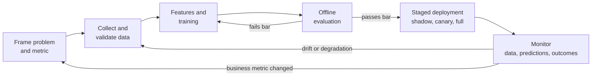

# ML Systems Lifecycle

> **TL;DR** — A model is a small part of an ML system. Reliable products come from treating data, training, evaluation, deployment and monitoring as one feedback loop, with every step versioned and reproducible.

## Why it matters

A notebook that scores well offline is not a product. Production systems fail through stale data, silent pipeline changes, training/serving skew and drift, not through the choice of optimizer. A disciplined lifecycle is what turns a model into something you can trust.

## Core ideas

1. **Frame the problem first.** Define the decision the model supports, the cost of each error type, and a baseline (a heuristic or a simple model) that any ML solution must beat.
2. **Data is the product.** Version datasets, record where each came from, and write validation checks (schema, ranges, missing rates) that run automatically.
3. **Evaluate like production.** Use time-based splits when the future differs from the past; slice metrics by subgroup to find hidden failures.
4. **Make training reproducible.** Pin code, data version, random seeds, library versions and hyperparameters; log them with every run.
5. **Deploy gradually.** Shadow mode, then canary traffic, then full rollout, with an easy rollback.
6. **Monitor and close the loop.** Track inputs, predictions, outcomes and latency; retrain on a trigger, not on a hunch.

## Diagram

## What to monitor

| Signal | What it tells you | Typical response |
|---|---|---|
| Input drift (feature distributions shift) | The world changed or an upstream pipeline broke | Investigate the source; consider retraining |
| Prediction drift | Model behaves differently on similar traffic | Compare against a baseline window |
| Concept drift (relationship between $x$ and $y$ changes) | The model's assumptions are stale | Retrain on recent labeled data |
| Latency and cost | Serving constraints (see [Transformers](transformers.md)) | Optimize, batch, quantize, cache |
| Outcome metrics with delayed labels | True performance, but late | Use proxy metrics meanwhile |
| Subgroup performance | Fairness and hidden regressions | Targeted data or thresholds |

## Worked example: a pre-deployment checklist

- [ ] Baseline defined and beaten on a held-out, time-correct split
- [ ] No leakage: preprocessing fit on training data only
- [ ] Metrics reported with confidence intervals, sliced by key subgroups
- [ ] Training and serving use the *same* feature code path
- [ ] Rollback plan and alert thresholds written down
- [ ] A named owner for the model after launch

## Pitfalls

- **Training/serving skew:** features computed one way in a batch job and another way online. Share the code.
- **Feedback loops:** the model's predictions change the data it will be retrained on (recommendations shape clicks). Keep an exploration or holdout slice.
- **Silent data failures:** a column that becomes constant or null rarely raises an exception. Validate data, not just code.
- **Optimizing offline metrics that do not match the business goal.**

## Related

- [Machine learning fundamentals](machine-learning-fundamentals.md) — the evaluation discipline this lifecycle protects.
- [Reinforcement learning](reinforcement-learning.md) — feedback loops are intrinsic there.
- [Probability & statistics](../mathematics/probability-and-statistics.md) — drift tests, confidence intervals.

## Further reading

- Sculley et al., "Hidden Technical Debt in Machine Learning Systems" (NeurIPS 2015).
- Huyen, *Designing Machine Learning Systems*.
