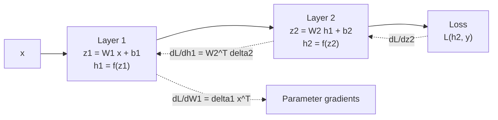

# Neural Networks and Backpropagation

> **TL;DR** — A neural network is a composition of simple differentiable layers. Backpropagation is just the chain rule applied efficiently from the output back to every parameter, and gradient descent uses those gradients to improve the weights.

## Why it matters

Backpropagation is the one algorithm underneath nearly all deep learning. Understanding it makes vanishing gradients, initialization, normalization and optimizer choices stop feeling like superstition.

## Core ideas

### A layer

Layer $l$ takes the previous activation $h^{(l-1)}$ and computes

$$
z^{(l)} = W^{(l)} h^{(l-1)} + b^{(l)}, \qquad h^{(l)} = \sigma\big(z^{(l)}\big)
$$

Without the non-linearity $\sigma$, any stack of layers collapses into a single linear map.

### Common activations

| Activation | Formula | Notes |
|---|---|---|
| ReLU | $\max(0, z)$ | Default for many nets; cheap; units can "die" |
| GELU | $z\,\Phi(z)$ | Smooth ReLU-like; common in transformers |
| tanh | $\tanh z$ | Zero-centered; saturates |
| Sigmoid | $1/(1+e^{-z})$ | Output probabilities; saturates, so avoid in deep hidden stacks |
| Softmax | $e^{z_i}/\sum_j e^{z_j}$ | Turns logits into a distribution |

### Backpropagation

Define the error signal $\delta^{(l)} = \partial L / \partial z^{(l)}$. Then, for a network with $L$ layers:

$$
\delta^{(L)} = \nabla_{h^{(L)}} L \odot \sigma'\big(z^{(L)}\big), \qquad
\delta^{(l)} = \Big( W^{(l+1)\top} \delta^{(l+1)} \Big) \odot \sigma'\big(z^{(l)}\big)
$$

$$
\frac{\partial L}{\partial W^{(l)}} = \delta^{(l)}\, h^{(l-1)\top}, \qquad
\frac{\partial L}{\partial b^{(l)}} = \delta^{(l)}
$$

The cost of one backward pass is about the same as one forward pass, which is what makes training billion-parameter models feasible. Frameworks such as PyTorch and JAX automate this as *automatic differentiation*.

### Optimizers

| Optimizer | Update idea |
|---|---|
| SGD | $\theta \leftarrow \theta - \eta\, g$ |
| SGD + momentum | Accumulate a velocity to smooth noisy gradients |
| Adam | Per-parameter step sizes from running estimates of the gradient's mean and variance |
| AdamW | Adam with decoupled weight decay; the common default for transformers |

## Diagram



Solid arrows are the forward pass; dashed arrows carry gradients backward.

## Worked example

A two-layer network (ReLU hidden layer, sigmoid output, binary cross-entropy) learning a non-linearly-separable rule: the label is 1 when the two inputs have the same sign. No linear model can solve this.

```python
import numpy as np

rng = np.random.default_rng(0)
X = rng.normal(size=(256, 2))
y = (X[:, 0] * X[:, 1] > 0).astype(float).reshape(-1, 1)

# He initialization for the ReLU layer
W1 = rng.normal(0, np.sqrt(2 / 2), size=(2, 16)); b1 = np.zeros((1, 16))
W2 = rng.normal(0, np.sqrt(2 / 16), size=(16, 1)); b2 = np.zeros((1, 1))
sigmoid = lambda z: 1 / (1 + np.exp(-z))

lr = 0.1
for step in range(2000):
    # forward
    z1 = X @ W1 + b1; a1 = np.maximum(0, z1)
    z2 = a1 @ W2 + b2; p = sigmoid(z2)
    loss = -np.mean(y * np.log(p + 1e-9) + (1 - y) * np.log(1 - p + 1e-9))
    # backward (sigmoid + BCE simplifies to p - y)
    dz2 = (p - y) / len(X)
    dW2 = a1.T @ dz2;  db2 = dz2.sum(0, keepdims=True)
    dz1 = (dz2 @ W2.T) * (z1 > 0)
    dW1 = X.T @ dz1;   db1 = dz1.sum(0, keepdims=True)
    for P, g in ((W1, dW1), (b1, db1), (W2, dW2), (b2, db2)):
        P -= lr * g

print(f"final loss {loss:.3f}, accuracy {((p > 0.5) == y).mean():.1%}")
```

Check your understanding: replace the analytic gradients with finite differences on a few weights and confirm they agree (a *gradient check*), the standard way to catch backprop bugs.

## Pitfalls

- **Vanishing/exploding gradients:** repeated multiplication by $W^\top$ and $\sigma'$ shrinks or blows up the signal. Mitigate with ReLU-family activations, careful initialization (Xavier for tanh, He for ReLU), residual connections and normalization layers.
- **Learning rate too high or too low:** the single most impactful hyperparameter. Plot the loss; spikes mean too high, a flat line means too low.
- **Forgetting to shuffle or normalize inputs:** unscaled features make the loss surface badly conditioned.
- **Train/eval mode mix-ups:** dropout and batch norm behave differently at inference time.

## Related

- [Machine learning fundamentals](machine-learning-fundamentals.md) — what the loss and regularizer are for.
- [Transformers](transformers.md) — the architecture built from these layers plus attention.
- [Calculus & optimization](../mathematics/calculus-and-optimization.md) — gradients, Jacobians and convergence.
- [Linear algebra](../mathematics/linear-algebra.md) — every layer is a matrix multiply.

## Further reading

- Goodfellow, Bengio, Courville, *Deep Learning*, chapter 6 (feedforward networks) and chapter 8 (optimization).
- Karpathy's "micrograd" lecture — building autograd from scratch in about 100 lines.
