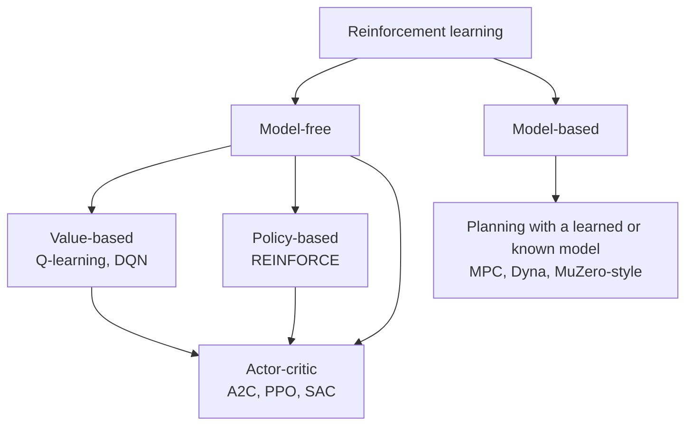
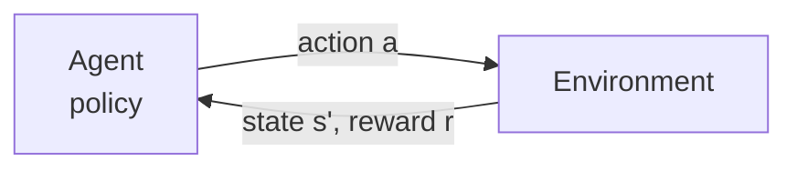

# Reinforcement Learning

> **TL;DR** — An agent learns a policy by trial and error to maximize cumulative reward. The Bellman equations turn "long-term value" into a recursive, learnable quantity.

## Why it matters

RL is the framework for sequential decision-making where the right action depends on long-term consequences: game playing, robot locomotion, resource allocation, and fine-tuning language models from preference feedback. It is also the learning-based cousin of optimal control (see [State space & LQR](../control-systems/state-space-and-lqr.md)).

## Core ideas

### The Markov decision process (MDP)

An MDP is a tuple $(\mathcal{S}, \mathcal{A}, P, R, \gamma)$: states, actions, transition probabilities $P(s' \mid s, a)$, reward function, and a discount factor $\gamma \in [0, 1)$. The **Markov property** says the next state depends only on the current state and action.

The **return** from time $t$ is

$$
G_t = \sum_{k=0}^{\infty} \gamma^k\, r_{t+k+1}
$$

A **policy** $\pi(a \mid s)$ maps states to actions. The goal is to find $\pi$ maximizing $\mathbb{E}[G_t]$.

### Value functions and the Bellman equations

$$
V^\pi(s) = \mathbb{E}_\pi\big[G_t \mid s_t = s\big], \qquad
Q^\pi(s,a) = \mathbb{E}_\pi\big[G_t \mid s_t = s, a_t = a\big]
$$

The optimal action-value function satisfies the Bellman optimality equation:

$$
Q^*(s,a) = \mathbb{E}\Big[\, r + \gamma \max_{a'} Q^*(s', a') \,\Big|\, s, a \Big]
$$

### Q-learning (off-policy, value-based)

After observing a transition $(s, a, r, s')$:

$$
Q(s,a) \leftarrow Q(s,a) + \alpha\Big[\, r + \gamma \max_{a'} Q(s', a') - Q(s,a) \,\Big]
$$

The bracketed term is the **temporal-difference (TD) error**. In tabular settings with sufficient exploration and decaying step sizes, Q-learning converges to $Q^*$. Deep Q-networks (DQN) replace the table with a neural network and add a replay buffer and target network for stability.

### Policy gradients

Parameterize the policy as $\pi_\theta$ and ascend the gradient of expected return:

$$
\nabla_\theta J(\theta) = \mathbb{E}\Big[\, \nabla_\theta \log \pi_\theta(a \mid s)\; \hat A(s,a) \,\Big]
$$

where $\hat A$ is an advantage estimate (how much better the action was than average). Subtracting a baseline reduces variance without adding bias.

## Diagram

A map of the algorithm families.

And the interaction loop:

## Worked example

A 1-D corridor with 4 cells, reward $+1$ for reaching the right end, $\gamma = 0.9$, $\alpha = 0.5$, all $Q = 0$ initially. The agent moves right from cell 3 into the goal and receives $r = 1$ (goal is terminal, so the future term is 0):

$$
Q(3,\text{right}) \leftarrow 0 + 0.5\,[\,1 + 0 - 0\,] = 0.5
$$

On a later episode, moving right from cell 2 to cell 3 (reward 0) updates:

$$
Q(2,\text{right}) \leftarrow 0 + 0.5\,[\,0 + 0.9 \times 0.5 - 0\,] = 0.225
$$

Reward information propagates backward one step per visit, which is why sparse rewards make learning slow.

## Pitfalls

- **Exploration vs exploitation:** purely greedy agents get stuck. Use $\epsilon$-greedy, entropy bonuses or optimism under uncertainty.
- **Reward hacking:** the agent optimizes the reward you wrote, not the one you meant. Test the reward function adversarially.
- **Sample inefficiency and instability:** deep RL is sensitive to seeds and hyperparameters; always report multiple runs.
- **Sim-to-real gap:** policies trained in simulation exploit simulator quirks. Domain randomization and system identification help (see [Robotics](../robotics/index.md)).

## Related

- [Neural networks & backprop](neural-networks-and-backprop.md) — function approximation for $Q$ and $\pi$.
- [Probability & statistics](../mathematics/probability-and-statistics.md) — expectations, Markov chains.
- [Motion planning](../robotics/motion-planning.md) — the non-learning alternative for known models.
- [State space & LQR](../control-systems/state-space-and-lqr.md) — exact optimal control for linear systems with quadratic cost.

## Further reading

- Sutton & Barto, *Reinforcement Learning: An Introduction* (2nd ed.) — the standard text, free online.
- Schulman et al., "Proximal Policy Optimization Algorithms" (2017).
