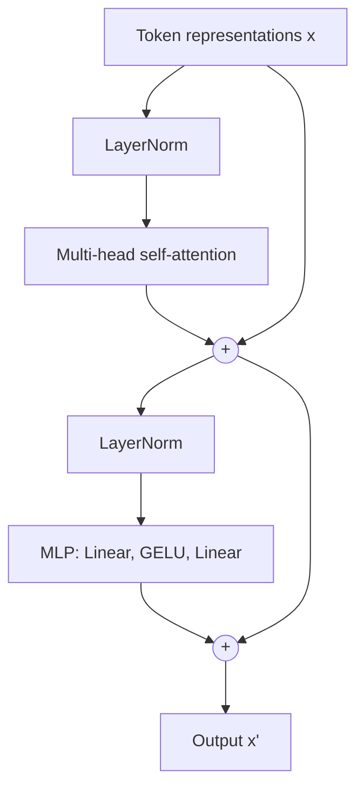

# Transformers

> **TL;DR** — A transformer lets every token look at every other token through *attention*, then refines each token with a small MLP, repeating the pattern in deep residual stacks. It parallelizes well on GPUs, which is why it scales.

## Why it matters

Transformers underpin large language models and are now standard in vision, speech, protein modeling and robotics policies. Knowing the block diagram and the cost model lets you reason about context length, memory use and inference speed.

## Core ideas

### Scaled dot-product attention

Each token produces a *query* $q$, *key* $k$ and *value* $v$ by linear projection. Attention scores compare queries with keys; the output is a weighted average of values:

$$
\text{Attention}(Q, K, V) = \text{softmax}\!\left(\frac{Q K^\top}{\sqrt{d_k}}\right) V
$$

The $\sqrt{d_k}$ scaling keeps dot products from growing with dimension, which would push the softmax into near-one-hot, small-gradient regions.

### Multi-head attention

Run $h$ attention operations in parallel on lower-dimensional projections, concatenate the results, and project back. Different heads can specialize in different relationships (syntax, position, copying).

### Position information

Attention is permutation-invariant, so order must be injected: sinusoidal or learned positional embeddings, or rotary embeddings (RoPE) that rotate queries and keys by position-dependent angles.

### Three architecture families

| Family | Attention mask | Typical use |
|---|---|---|
| Encoder-only | Bidirectional | Classification, embeddings (BERT-style) |
| Decoder-only | Causal (token $t$ sees tokens $\le t$) | Text generation (GPT-style) |
| Encoder-decoder | Bidirectional encoder, causal decoder with cross-attention | Translation, summarization (T5-style) |

## Diagram

One pre-norm transformer block. Residual connections let gradients flow straight through the stack.

## Key facts and costs

- Self-attention over a sequence of length $n$ with model width $d$ costs $O(n^2 d)$ time and $O(n^2)$ memory for the score matrix. Doubling the context roughly quadruples attention cost.
- The MLP and projections cost $O(n d^2)$. For short contexts the MLP dominates; for long contexts attention does.
- **KV cache:** during autoregressive generation, keys and values of past tokens are stored and reused, so each new token costs $O(n d)$ instead of recomputing everything. Memory for the cache grows linearly with context length, layers and heads.
- **Scaling behavior:** empirically, loss falls as a smooth power law in parameters, data and compute (Kaplan et al., 2020). Hoffmann et al. (2022, "Chinchilla") showed that for a fixed compute budget, model size and training tokens should be scaled together.

## Worked example

Single-head attention for 3 tokens with $d_k = 2$. Suppose the unscaled score row for token 1 is $[2.0,\ 0.5,\ 0.0]$.

1. Scale by $\sqrt{2} \approx 1.414$: $[1.414,\ 0.354,\ 0.0]$.
2. Exponentiate: $[4.11,\ 1.42,\ 1.00]$; sum $= 6.53$.
3. Softmax weights: $[0.63,\ 0.22,\ 0.15]$.
4. Output for token 1 is $0.63\,v_1 + 0.22\,v_2 + 0.15\,v_3$.

## Pitfalls

- **Forgetting the causal mask** in decoder training lets the model peek at future tokens and produces a model that cannot generate.
- **Context length is not free:** quadratic attention cost and KV-cache memory are why long-context inference is expensive. Techniques such as FlashAttention reduce memory traffic but not the asymptotic arithmetic.
- **Quality does not equal length:** a model that accepts a long context does not necessarily use all of it well.

## Related

- [Neural networks & backprop](neural-networks-and-backprop.md) — layers, residuals and normalization.
- [Linear algebra](../mathematics/linear-algebra.md) — attention is matrix multiplication plus a softmax.
- [ML systems lifecycle](ml-systems-lifecycle.md) — serving cost, latency and monitoring.

## Further reading

- Vaswani et al., "Attention Is All You Need" (2017) — the original architecture.
- Kaplan et al., "Scaling Laws for Neural Language Models" (2020); Hoffmann et al., "Training Compute-Optimal Large Language Models" (2022).
