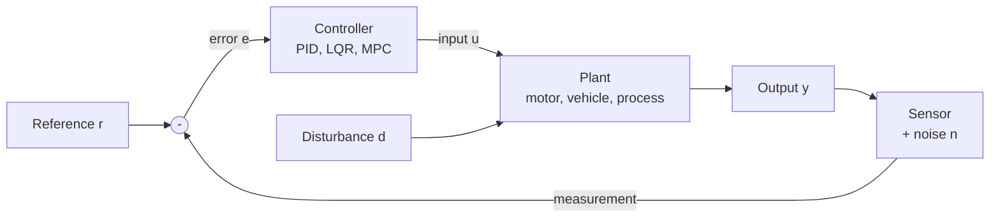

# Control Systems

> **Scope** — Making dynamic systems behave: feedback, stability, tuning, and optimal control. The shared language between robotics, aerospace, electronics and process engineering.

## Visual summary

## Notes

| Note | Status | One-line summary |
|---|---|---|
| [PID control](pid-control.md) | growing | What P, I and D each do, tuning, anti-windup, and a simulation you can run |
| [Stability & frequency response](stability-and-frequency-response.md) | growing | Poles, second-order behavior, Bode plots and stability margins |
| [State space & LQR](state-space-and-lqr.md) | growing | Controllability, optimal gain design, and the link to Kalman filtering |

## Suggested reading order

PID control first for intuition, then Stability for the theory that explains why tuning behaves as it does, then State space & LQR for multi-variable and optimal design.

## Related topics

- [Robotics](../robotics/index.md) — controllers sit between planners and actuators.
- [Electronics](../electronics/index.md) — implementing loops on microcontrollers.
- [Aerospace](../aerospace/index.md) — guidance, navigation and control.
- [Mathematics](../mathematics/index.md) — linear algebra and calculus underneath.
