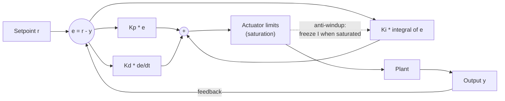

# PID Control

> **TL;DR** — A PID controller computes its command from the present error (P), the accumulated past error (I) and the error's rate of change (D). It handles most single-loop problems when tuned with care, and fails predictably when you ignore saturation, noise or delay.

## Why it matters

Well over 90% of industrial control loops are PI or PID: motor speed, temperature, drone attitude, pressure. If you can reason about PID behavior you can debug most real control problems.

## Core ideas

### The law

$$
u(t) = K_p\, e(t) + K_i \int_0^t e(\tau)\, d\tau + K_d\, \frac{de(t)}{dt}, \qquad e = r - y
$$

| Term | Acts on | Effect | Cost |
|---|---|---|---|
| P | Present error | Faster response, smaller error | Too much gives overshoot and oscillation; leaves steady-state error on most plants |
| I | Past error | Eliminates steady-state error | Adds lag; causes overshoot and **windup** |
| D | Predicted error | Adds damping, reduces overshoot | Amplifies sensor noise; "kicks" on setpoint steps |

### Effect of increasing each gain (rule of thumb)

| Gain | Rise time | Overshoot | Settling time | Steady-state error |
|---|---|---|---|---|
| $K_p$ ↑ | Decreases | Increases | Small change | Decreases |
| $K_i$ ↑ | Decreases | Increases | Increases | Eliminates |
| $K_d$ ↑ | Small change | Decreases | Decreases | No effect |

### Tuning

- **Manual:** set $K_i = K_d = 0$, raise $K_p$ until the response is fast but only mildly oscillatory, add $K_d$ to damp, add a little $K_i$ to remove residual error.
- **Ziegler-Nichols (ultimate gain method):** with only P, raise $K_p$ until sustained oscillation at gain $K_u$ and period $T_u$. Then for a PID: $K_p = 0.6K_u$, $T_i = T_u/2$, $T_d = T_u/8$ (with $K_i = K_p/T_i$ and $K_d = K_p T_d$). It gives aggressive, oscillatory tuning, so treat it as a starting point.
- **Model-based:** identify the plant (for example a first-order plus dead-time model) and use IMC or lambda tuning.

### Practical implementation details

- **Anti-windup:** when the actuator saturates, stop integrating (conditional integration) or back-calculate the integrator. Otherwise the integral grows while the output is stuck, then causes a huge overshoot.
- **Derivative filtering:** differentiate a low-pass-filtered signal, and preferably differentiate the *measurement* rather than the error to avoid setpoint kick.
- **Fixed sample time:** discretize with a constant $\Delta t$; jitter changes the effective gains.

## Diagram



## Worked example

Simulate a first-order plant $\tau\,\dot y = -y + u$ (time constant $\tau = 1$ s, unit DC gain), actuator limited to $\pm 5$, setpoint step to 1.

```python
import numpy as np

def simulate(kp, ki, kd, setpoint=1.0, dt=0.01, T=10.0, tau=1.0, umax=5.0):
    y, integral, prev_err = 0.0, 0.0, setpoint
    ys = []
    for _ in range(int(T / dt)):
        err = setpoint - y
        d = (err - prev_err) / dt
        u_unsat = kp * err + ki * integral + kd * d
        u = np.clip(u_unsat, -umax, umax)
        if u == u_unsat:               # conditional-integration anti-windup
            integral += err * dt
        y += dt * (-y + u) / tau
        prev_err = err
        ys.append(y)
    return np.array(ys)

for name, gains in {"P only": (4, 0, 0), "PI": (4, 4, 0),
                    "PID": (4, 4, 0.5), "PI, high Ki": (4, 40, 0)}.items():
    ys = simulate(*gains)
    print(f"{name:11s} overshoot {max(0, ys.max() - 1) * 100:5.1f}%  final {ys[-1]:.3f}")
```

Results from running this:

| Controller | Overshoot | Final value | Reading |
|---|---|---|---|
| P only ($K_p = 4$) | 0% | 0.800 | Steady-state error of $1/(1+K_p) = 0.2$ |
| PI ($K_p = 4$, $K_i = 4$) | 0% | 1.000 | Integral action removes the offset |
| PID (add $K_d = 0.5$) | about 4% | 1.000 | On a plain first-order plant D adds little, and here it kicks on the setpoint step |
| PI with $K_i = 40$ | about 32% | 1.000 | Too much integral gain: fast but badly overshooting |

The P-only result follows from algebra: for unit plant gain, $y_{ss} = K_p/(1+K_p) = 0.8$. Derivative action earns its keep on plants with more lag (second order and higher), not on this one.

## Pitfalls

- **Windup** after long saturation (valves, heaters, motors at their limit).
- **Derivative on noisy signals:** quantized encoder or ADC noise gets amplified; filter it.
- **Dead time:** a delay in the loop limits achievable bandwidth; raising gains just destabilizes it.
- **Nonlinear plants (friction, backlash):** a fixed linear controller can limit-cycle; add feedforward or gain scheduling.
- **Tuning at one operating point** and deploying across a wide range.

## Related

- [Stability & frequency response](stability-and-frequency-response.md) — why too much gain oscillates, and how to measure margins.
- [State space & LQR](state-space-and-lqr.md) — the multi-variable, optimal alternative.
- [Microcontrollers & buses](../electronics/microcontrollers-and-buses.md) — running the loop at a fixed rate with PWM outputs and ADC inputs.
- [Sense-plan-act architecture](../robotics/sense-plan-act.md) — PID as the bottom layer.

## Further reading

- Åström & Murray, *Feedback Systems: An Introduction for Scientists and Engineers*, free online.
- Åström & Hägglund, *Advanced PID Control*.
