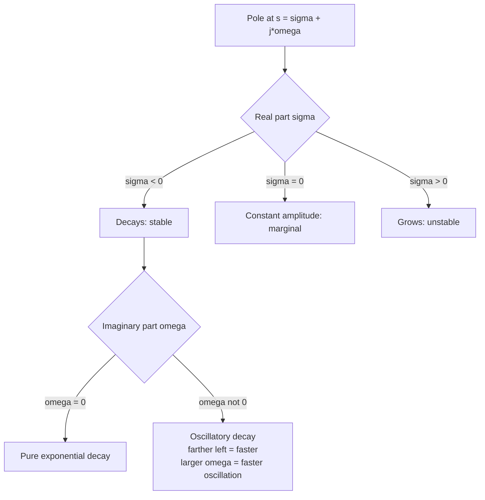

# Stability and Frequency Response

> **TL;DR** — A linear system is stable when all poles of its transfer function lie in the left half of the complex plane. Pole locations predict time-domain behavior, and the Bode plot tells you how much gain and phase margin a feedback loop has before it goes unstable.

## Why it matters

Stability is the first requirement of any controller. The frequency-domain view gives engineering intuition that simulation alone does not: where the loop is fast, where noise gets amplified, and how far you are from the edge.

## Core ideas

### Transfer functions and poles

The Laplace transform turns linear differential equations into algebra. A system is described by

$$
G(s) = \frac{N(s)}{D(s)}
$$

The roots of $D(s)$ are the **poles**. A pole at $s = \sigma + j\omega$ contributes a response term $e^{\sigma t}$ times oscillation at $\omega$:

- $\sigma < 0$: decays (stable)
- $\sigma = 0$: neither grows nor decays (marginal)
- $\sigma > 0$: grows without bound (unstable)

For discrete-time systems the stability boundary is the unit circle: poles must have $|z| < 1$.

### Second-order systems

The standard form

$$
G(s) = \frac{\omega_n^2}{s^2 + 2\zeta\omega_n s + \omega_n^2}
$$

has natural frequency $\omega_n$ and damping ratio $\zeta$:

| Damping | Poles | Step response |
|---|---|---|
| $\zeta = 0$ | Imaginary pair | Sustained oscillation |
| $0 < \zeta < 1$ | Complex pair, left half-plane | Oscillatory decay (underdamped) |
| $\zeta = 1$ | Repeated real pole | Fastest without overshoot (critically damped) |
| $\zeta > 1$ | Two real poles | Slow, no overshoot (overdamped) |

For $0<\zeta<1$ the percent overshoot depends only on $\zeta$:

$$
M_p = \exp\!\left(\frac{-\pi\zeta}{\sqrt{1-\zeta^2}}\right)
$$

For example $\zeta = 0.5$ gives about 16% overshoot, and $\zeta = 0.707$ about 4.3%. The 2% settling time is roughly $4/(\zeta\omega_n)$.

### Testing stability without finding roots

- **Routh-Hurwitz criterion:** a table built from the characteristic polynomial's coefficients; the number of sign changes in the first column equals the number of right-half-plane roots.
- **Root locus:** how closed-loop poles move as a gain increases.
- **Nyquist / Bode:** use the open-loop frequency response $L(j\omega)$ to judge closed-loop stability.

### Margins from the Bode plot

For a loop with open-loop transfer function $L(s) = C(s)G(s)$:

- **Gain margin:** how much the gain can increase at the frequency where phase is $-180^\circ$ before instability.
- **Phase margin:** how much extra phase lag can be tolerated at the gain crossover frequency (where $|L| = 1$).

Rules of thumb: aim for a phase margin of roughly $45^\circ$ to $60^\circ$ and a gain margin above about 6 dB. Small margins mean oscillatory response and sensitivity to modeling error. Time delay adds phase lag $-\omega T$ without changing gain, which is why delays erode margins.

## Diagram

Pole location to behavior, on the $s$-plane:

## Worked example

Closed loop: unity feedback around $C(s)G(s) = \dfrac{K}{s(s+1)(s+2)}$. The characteristic equation is $s^3 + 3s^2 + 2s + K = 0$.

Routh array:

| Row | Entries |
|---|---|
| $s^3$ | $1,\ 2$ |
| $s^2$ | $3,\ K$ |
| $s^1$ | $(6 - K)/3$ |
| $s^0$ | $K$ |

Stability needs every first-column entry positive: $K > 0$ and $K < 6$. At $K = 6$ the loop is marginal, oscillating at $\omega = \sqrt{2}$ rad/s (from the auxiliary equation $3s^2 + 6 = 0$). So the **gain margin** of the loop at $K = 1$ is $6/1 = 6$, about 15.6 dB.

## Pitfalls

- **Judging stability from the open-loop poles:** it is the *closed-loop* poles that matter.
- **Ignoring delay and unmodeled dynamics:** a plant that looks second order may hide actuator lag and sensor filters that eat phase margin.
- **Right-half-plane zeros** limit achievable bandwidth no matter how clever the controller.
- **Linear analysis for nonlinear systems:** valid only near the operating point; saturation can destabilize a loop that is stable for small signals.

## Related

- [PID control](pid-control.md) — practical tuning, whose behavior this note explains.
- [State space & LQR](state-space-and-lqr.md) — stability as eigenvalues of $A$.
- [Linear algebra](../mathematics/linear-algebra.md) — eigenvalues are the state-space poles.
- [Circuit fundamentals](../electronics/circuit-fundamentals.md) — an RC filter is the simplest first-order frequency response.

## Further reading

- Franklin, Powell, Emami-Naeini, *Feedback Control of Dynamic Systems*.
- Ogata, *Modern Control Engineering*.
