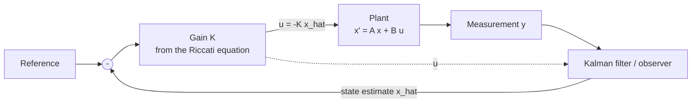

# State Space and LQR

> **TL;DR** — State-space models describe a system with first-order matrix equations, which handle many inputs and outputs naturally. LQR picks the feedback gain $K$ that minimizes a quadratic cost trading off state error against control effort, by solving one matrix equation.

## Why it matters

Real machines have many coupled states (position, velocity, angle, angular rate). State-space design handles them together, gives a systematic recipe for optimal gains, and connects directly to Kalman filtering and to modern techniques like model predictive control.

## Core ideas

### The model

$$
\dot x = A x + B u, \qquad y = C x + D u
$$

$x$ is the state, $u$ the input and $y$ the output. The system's poles are the eigenvalues of $A$. With state feedback $u = -Kx$ the closed loop is $\dot x = (A - BK)x$, so choosing $K$ moves the poles.

### Controllability and observability

- **Controllable:** the inputs can steer the state anywhere. Test: $[B\ \ AB\ \ A^2B\ \cdots\ A^{n-1}B]$ has rank $n$.
- **Observable:** the state can be reconstructed from the outputs. Test: $[C;\ CA;\ \cdots;\ CA^{n-1}]$ has rank $n$.

Pole placement requires controllability; designing an observer requires observability.

### Linear-quadratic regulator (LQR)

Minimize

$$
J = \int_0^\infty \big( x^\top Q x + u^\top R u \big)\, dt, \qquad Q \succeq 0,\ R \succ 0
$$

The optimal law is $u = -Kx$ with

$$
K = R^{-1} B^\top P, \qquad A^\top P + P A - P B R^{-1} B^\top P + Q = 0
$$

The second equation is the **algebraic Riccati equation (ARE)**, solved numerically. For a controllable and detectable system, the LQR loop is guaranteed stable.

**Choosing $Q$ and $R$:** larger entries in $Q$ penalize those state errors more (faster, more aggressive); larger $R$ penalizes control effort (gentler, slower). A common start is Bryson's rule: set each diagonal entry to $1/(\text{max acceptable value})^2$.

### Observers and LQG

When states cannot be measured, estimate them with an observer or [Kalman filter](../robotics/state-estimation.md). The **separation principle** says that for linear systems you can design the LQR gain and the estimator independently and combine them (LQG control); the combination is stable, though robustness margins can be poor and should be checked.

## Diagram



## Worked example: the double integrator

A mass with unit mass and force input: $x = [\text{position},\ \text{velocity}]^\top$, $A = \begin{bmatrix}0&1\\0&0\end{bmatrix}$, $B = \begin{bmatrix}0\\1\end{bmatrix}$. Take $Q = I$, $R = 1$. The ARE has the solution

$$
P = \begin{bmatrix}\sqrt{3} & 1\\ 1 & \sqrt{3}\end{bmatrix}, \qquad K = R^{-1}B^\top P = \begin{bmatrix}1 & \sqrt{3}\end{bmatrix}
$$

The closed-loop matrix $A - BK = \begin{bmatrix}0&1\\-1&-\sqrt{3}\end{bmatrix}$ has characteristic polynomial $s^2 + \sqrt{3}\,s + 1$, so $\omega_n = 1$ and $\zeta = \sqrt{3}/2 \approx 0.87$, a well-damped response.

```python
import numpy as np
from scipy.linalg import solve_continuous_are

A = np.array([[0, 1], [0, 0.0]]); B = np.array([[0], [1.0]])
Q = np.eye(2); R = np.array([[1.0]])

P = solve_continuous_are(A, B, Q, R)
K = np.linalg.solve(R, B.T @ P)
print("K =", K)                                   # [[1.0, 1.7321]]
print("poles =", np.linalg.eigvals(A - B @ K))    # -0.866 +/- 0.5j
```

## Pitfalls

- **Model mismatch:** LQR is optimal for the *model*. Unmodeled lag, delay and saturation can degrade or destabilize the real system; verify with simulation and margin checks.
- **Poor scaling of states:** if one state is in meters and another in radians, raw $Q = I$ means little. Normalize or use Bryson's rule.
- **Regulation vs tracking:** plain LQR drives states to zero; for setpoint tracking add integral action or a feedforward term.
- **No constraints:** LQR ignores actuator limits. Model predictive control handles constraints at higher computational cost.

## Related

- [PID control](pid-control.md) — the single-loop alternative.
- [Stability & frequency response](stability-and-frequency-response.md) — poles, margins.
- [State estimation](../robotics/state-estimation.md) — the Kalman filter, LQR's dual.
- [Linear algebra](../mathematics/linear-algebra.md) — rank tests and eigenvalues.
- [Reinforcement learning](../ai/reinforcement-learning.md) — the model-free relative of optimal control.

## Further reading

- Anderson & Moore, *Optimal Control: Linear Quadratic Methods*.
- Åström & Murray, *Feedback Systems*, chapters on state feedback and observers.
