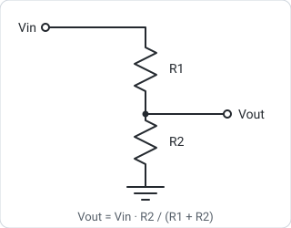
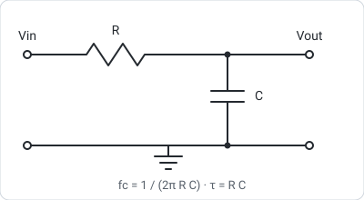
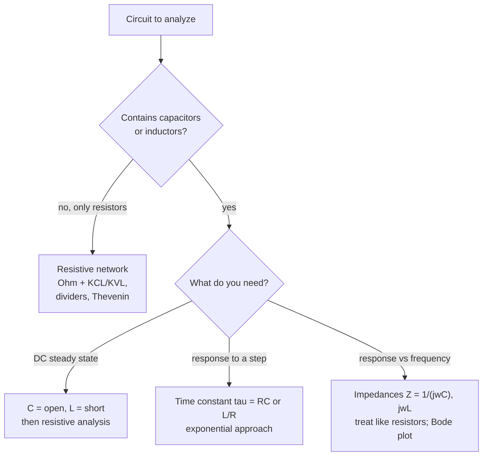

# Circuit Fundamentals

> **TL;DR** — Two conservation laws (Kirchhoff's current and voltage laws) plus component relationships (Ohm's law, $i = C\,dv/dt$, $v = L\,di/dt$) are enough to analyze almost any circuit you will meet in practice.

## Why it matters

Before debugging a sensor front end, sizing a motor driver or choosing a filter, you need fast mental models for current, voltage and time constants. Most "mysterious" circuit behavior is a loaded divider, a missing current limit, or an RC time constant you forgot about.

## Core ideas

### The laws

| Law | Statement |
|---|---|
| Ohm | $V = IR$ |
| Power | $P = VI = I^2R = V^2/R$ |
| KCL | Currents into a node sum to zero (charge is conserved) |
| KVL | Voltages around any closed loop sum to zero (energy is conserved) |

Combining resistors:

$$
R_{series} = R_1 + R_2 + \cdots, \qquad \frac{1}{R_{parallel}} = \frac{1}{R_1} + \frac{1}{R_2} + \cdots
$$

### The voltage divider

$$
V_{out} = V_{in}\,\frac{R_2}{R_1 + R_2}
$$

This holds only if nothing loads the output. A load $R_L$ in parallel with $R_2$ lowers $V_{out}$; the divider is a good voltage source only if $R_L \gg R_2$ (a common rule is at least ten times larger).

### Capacitors and inductors

$$
i_C = C\,\frac{dv}{dt}, \qquad v_L = L\,\frac{di}{dt}
$$

A capacitor resists changes in voltage; an inductor resists changes in current. At DC a capacitor is an open circuit and an inductor a short.

### RC behavior

Step input $V$ applied to the RC network above:

$$
v_{out}(t) = V\left(1 - e^{-t/\tau}\right), \qquad \tau = RC
$$

After one time constant the output reaches 63.2% of its final value; after $5\tau$ about 99.3%.

In the frequency domain this is a first-order **low-pass filter** with corner (cutoff) frequency

$$
f_c = \frac{1}{2\pi RC}
$$

At $f_c$ the output is down 3 dB (amplitude $\approx 0.707$) with $-45^\circ$ phase, and it rolls off at 20 dB per decade above that.

### Thevenin equivalent

Any linear two-terminal network looks like a voltage source $V_{th}$ in series with a resistance $R_{th}$. Find $V_{th}$ as the open-circuit voltage and $R_{th}$ by turning off independent sources and looking back into the terminals. It is the quickest way to analyze loading.

## Diagram

A decision guide for choosing an analysis method:

## Worked examples

**LED current limiting.** Supply 5 V, LED forward voltage about 2.0 V, target 10 mA:

$$
R = \frac{5 - 2.0}{0.010} = 300\ \Omega
$$

Choose the nearest standard value, 330 Ω. Actual current: $3.0/330 \approx 9.1$ mA. Resistor dissipation: $I^2R = (0.0091)^2 \times 330 \approx 27$ mW, so a 1/8 W resistor is ample.

**Loaded divider.** $R_1 = R_2 = 10\ \text{k}\Omega$ with $V_{in} = 5$ V gives 2.5 V unloaded. Attach a 10 kΩ load: $R_2 \parallel R_L = 5\ \text{k}\Omega$, so

$$
V_{out} = 5 \times \frac{5}{10 + 5} \approx 1.67\ \text{V}
$$

Loading dropped the output by a third. This is the usual cause of a sensor reading that "sags" when the next stage is connected; buffer with an op-amp follower or lower the divider resistances.

**RC filter sizing.** $R = 10\ \text{k}\Omega$, $C = 100\ \text{nF}$: $\tau = 1$ ms and $f_c = 1/(2\pi\times10^{-3}) \approx 159$ Hz. Useful as an anti-aliasing or debounce filter for slow signals.

## Pitfalls

- **No current limit on LEDs and diodes.** Their exponential characteristic (see [Quantum & semiconductors](../physics/quantum-and-semiconductors.md)) means a small voltage excess causes a huge current.
- **Ignoring source and load impedance** when using dividers and filters.
- **Resistor power rating:** compute $P = I^2R$ and derate; small surface-mount parts are often only 1/10 W.
- **Component tolerances:** 5% resistors and 20% capacitors shift cutoff frequencies; ceramic capacitors lose capacitance under DC bias.
- **Real components are not ideal:** capacitors have ESR and ESL, resistors have parasitic inductance, wires have resistance.

## Related

- [Electromagnetism](../physics/electromagnetism.md) — the field theory behind $L$ and $C$.
- [Stability & frequency response](../control-systems/stability-and-frequency-response.md) — Bode plots generalize the RC filter.
- [Thermodynamics](../physics/thermodynamics.md) — dissipated power becomes heat.
- [Microcontrollers & buses](microcontrollers-and-buses.md) — where these basics meet digital systems.

## Further reading

- Horowitz & Hill, *The Art of Electronics* — the practical classic.
- Sedra & Smith, *Microelectronic Circuits* — rigorous analog design.
