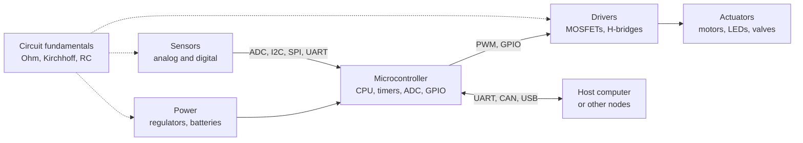

# Electronics

> **Scope** — Analyzing and building circuits: the laws that govern them, the passive and active parts they are made of, and the microcontrollers and buses that tie sensors, actuators and software together.

## Visual summary

## Notes

| Note | Status | One-line summary |
|---|---|---|
| [Circuit fundamentals](circuit-fundamentals.md) | growing | Ohm, Kirchhoff, dividers, RC behavior and worked LED and filter examples |
| [Microcontrollers & buses](microcontrollers-and-buses.md) | growing | GPIO, ADC, PWM, interrupts and UART, I2C, SPI, CAN compared |

## Suggested reading order

Circuit fundamentals first, then Microcontrollers & buses. Read [Quantum & semiconductors](../physics/quantum-and-semiconductors.md) for what is inside the diodes and transistors.

## Related topics

- [Physics](../physics/index.md) — electromagnetism and semiconductor physics.
- [Control systems](../control-systems/index.md) — loops implemented on these platforms.
- [Robotics](../robotics/index.md) — sensors and drivers in context.
