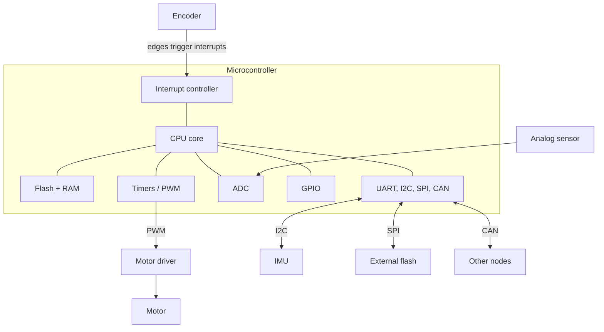

# Microcontrollers and Buses

> **TL;DR** — A microcontroller bundles a CPU, memory and peripherals (GPIO, ADC, timers/PWM, serial interfaces) on one chip. Real-time behavior comes from timers and interrupts, and sensors and actuators connect through a handful of standard buses, each with clear trade-offs.

## Why it matters

Almost every robot, instrument and appliance has a microcontroller at the bottom of its stack. Knowing what each peripheral does, and what a bus costs in wires, speed and complexity, is the difference between a clean design and a week of intermittent bugs.

## Core ideas

### Peripherals

| Peripheral | What it does | Typical use |
|---|---|---|
| GPIO | Digital pin as input or output | Buttons, LEDs, chip selects |
| ADC | Converts a voltage to an integer | Analog sensors, battery monitoring |
| Timer / PWM | Counts clock cycles; generates fixed-frequency pulses with adjustable duty cycle | Motor speed, servo signals, control-loop ticks |
| Interrupt controller | Pauses the main code to run a handler on an event | Encoders, timers, incoming bytes |
| UART / I²C / SPI / CAN | Serial communication | Talking to sensors, drivers and other boards |
| DMA | Moves data without CPU involvement | High-rate ADC or SPI streams |

### ADC and PWM arithmetic

An $N$-bit ADC with reference $V_{ref}$ resolves steps of

$$
\text{LSB} = \frac{V_{ref}}{2^N}
$$

The signal must be sampled above twice its highest frequency component (the Nyquist criterion), and frequencies above that must be removed by an analog anti-alias filter (an [RC filter](circuit-fundamentals.md) is the simplest).

PWM approximates an analog level by switching fast: average output $\approx D \times V_{supply}$ for duty cycle $D$, valid when the load (a motor's inductance, an RC filter) smooths the pulses.

### Choosing a bus

| Bus | Wires | Topology | Typical speed | Notes |
|---|---|---|---|---|
| UART | TX, RX (+GND) | Point-to-point, asynchronous | 9.6 kbit/s to a few Mbit/s | Simple; both ends must agree on baud rate |
| I²C | SDA, SCL (open-drain, needs pull-ups) | Multi-device, 7-bit addresses | 100 kHz, 400 kHz, 1 MHz | Few wires; slower; address conflicts possible |
| SPI | SCLK, MOSI, MISO, one CS per device | One controller, many peripherals | Several MHz to tens of MHz | Fast, full duplex; more wires as devices grow |
| CAN | CANH, CANL differential pair | Multi-master bus | Up to 1 Mbit/s (classic CAN) | Noise-robust with built-in arbitration and error handling; common in vehicles and robots |

## Diagram



## Worked examples

**ADC resolution.** A 12-bit ADC with $V_{ref} = 3.3$ V has $\text{LSB} = 3.3/4096 \approx 0.806$ mV. A raw reading of 2048 corresponds to about 1.65 V. Real noise often limits usable resolution to fewer bits than the nominal figure.

**PWM average.** A 3.3 V output at 25% duty averages $0.25\times3.3 = 0.825$ V (after filtering).

**UART throughput.** At 115200 baud with 8N1 framing (1 start + 8 data + 1 stop = 10 bits per byte): $115200/10 = 11{,}520$ bytes/s, so sending 1 kB takes about 87 ms. Plan buffer sizes and update rates around this limit.

**A fixed-rate control loop (pattern).**

```c
volatile bool tick = false;

void TIMER_ISR(void) {      // fires every 1 ms from a hardware timer
    tick = true;            // keep ISRs tiny: set a flag, do the work outside
}

int main(void) {
    setup();
    while (1) {
        if (tick) {
            tick = false;
            float y = read_sensor();
            float u = pid_update(y);   // see PID control note
            write_pwm(u);
        }
    }
}
```

## Pitfalls

- **Floating inputs:** an unconnected GPIO reads random values. Use pull-up or pull-down resistors.
- **Missing I²C pull-ups** (or values too large for the bus speed and capacitance): the bus appears dead or flaky.
- **Mismatched logic levels:** a 5 V device driving a 3.3 V pin can damage it; use level shifters or dividers.
- **Contact bounce:** mechanical switches chatter for milliseconds; debounce in hardware (RC) or software.
- **Heavy work in interrupt handlers** and unprotected shared variables: mark shared variables `volatile` and keep critical sections short.
- **No common ground** between boards, or noisy motor current sharing the ADC reference path, corrupts readings. Decouple supplies with capacitors close to the chip.
- **Blocking delays** (`delay(100)`) in the main loop destroy loop timing; use timers.

## Related

- [Circuit fundamentals](circuit-fundamentals.md) — pull-ups, dividers and filters.
- [PID control](../control-systems/pid-control.md) — the loop this hardware executes.
- [Sense-plan-act architecture](../robotics/sense-plan-act.md) — buses as the nervous system of a robot.
- [Quantum & semiconductors](../physics/quantum-and-semiconductors.md) — CMOS logic levels and I/O behavior.

## Further reading

- Elecia White, *Making Embedded Systems*.
- The reference manual and datasheet for your specific microcontroller; they are the real documentation.
