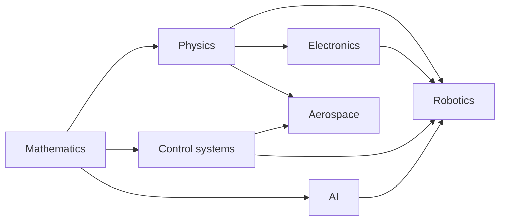

# Engineering and AI Knowledge Base

A personal, Markdown-based knowledge base covering the foundations of engineering and AI: concise notes with diagrams, equations and worked examples that you can check.

## How the topics connect

## Topics

| Topic | What it covers | Notes |
|---|---|---|
| [Artificial intelligence](ai/index.md) | Learning theory, neural networks, transformers, reinforcement learning, ML systems | 5 |
| [Robotics](robotics/index.md) | Architecture, kinematics, state estimation, motion planning | 4 |
| [Control systems](control-systems/index.md) | PID, stability and frequency response, state space and LQR | 3 |
| [Physics](physics/index.md) | Mechanics, thermodynamics, electromagnetism, quantum and semiconductors | 4 |
| [Electronics](electronics/index.md) | Circuit fundamentals, microcontrollers and buses | 2 |
| [Aerospace](aerospace/index.md) | Orbital mechanics, rocket equation, aerodynamics | 3 |
| [Mathematics](mathematics/index.md) | Linear algebra, probability and statistics, calculus and optimization | 3 |

Reference pages: [Glossary](glossary.md), [Reading list](reading-list.md), [Tags](tags.md), [Conventions](meta/conventions.md).

## Learning paths

Suggested orders if you want a route rather than a menu.

### Learning machines

[Linear algebra](mathematics/linear-algebra.md) → [Probability & statistics](mathematics/probability-and-statistics.md) → [Calculus & optimization](mathematics/calculus-and-optimization.md) → [ML fundamentals](ai/machine-learning-fundamentals.md) → [Neural networks](ai/neural-networks-and-backprop.md) → [Transformers](ai/transformers.md) → [Reinforcement learning](ai/reinforcement-learning.md)

### Robots that move

[Classical mechanics](physics/classical-mechanics.md) → [Kinematics](robotics/kinematics.md) → [PID control](control-systems/pid-control.md) → [State estimation](robotics/state-estimation.md) → [Motion planning](robotics/motion-planning.md) → [Sense-plan-act architecture](robotics/sense-plan-act.md)

### Going to space

[Classical mechanics](physics/classical-mechanics.md) → [Rocket equation](aerospace/rocket-equation-and-staging.md) → [Orbital mechanics](aerospace/orbital-mechanics.md) → [Aerodynamics](aerospace/aerodynamics-basics.md) → [State space & LQR](control-systems/state-space-and-lqr.md)

### From electrons to embedded code

[Circuit fundamentals](electronics/circuit-fundamentals.md) → [Quantum & semiconductors](physics/quantum-and-semiconductors.md) → [Microcontrollers & buses](electronics/microcontrollers-and-buses.md) → [PID control](control-systems/pid-control.md)

## Status legend

Each note carries a `status` in its front matter: `seed` (draft), `growing` (useful, still improving) or `evergreen` (reviewed and stable). See [Conventions](meta/conventions.md) for the full rules.
