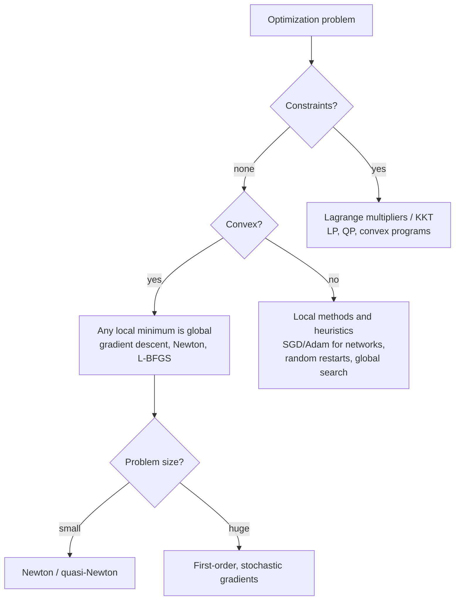

# Calculus and Optimization

> **TL;DR** — The gradient points uphill, so stepping against it reduces a function. Gradient descent, Newton's method and Lagrange multipliers are all ways of using derivatives to find the best point, and convexity tells you when the answer is trustworthy.

## Why it matters

Training a network, fitting a model, tuning a controller, planning a trajectory and designing a wing are all optimization problems. Knowing how step size, curvature and constraints interact explains most optimizer behavior you will observe.

## Core ideas

### Derivatives in many dimensions

For $f:\mathbb{R}^n\to\mathbb{R}$:

- **Gradient** $\nabla f$: vector of partial derivatives; direction of steepest increase.
- **Hessian** $H$: matrix of second derivatives; describes curvature.

For $F:\mathbb{R}^n\to\mathbb{R}^m$, the **Jacobian** $J$ holds $\partial F_i/\partial x_j$. The chain rule in matrix form is $J_{F\circ G} = J_F\,J_G$, which is exactly what backpropagation exploits.

Second-order Taylor approximation near $x$:

$$
f(x+\delta) \approx f(x) + \nabla f(x)^\top\delta + \tfrac12\,\delta^\top H(x)\,\delta
$$

### Gradient descent

$$
x_{k+1} = x_k - \eta\,\nabla f(x_k)
$$

For a quadratic $f(x) = \tfrac12 x^\top A x - b^\top x$ with $A$ symmetric positive definite and eigenvalues in $[\mu, L]$:

- Converges iff $0 < \eta < 2/L$.
- The best fixed step is $\eta = 2/(L+\mu)$, giving error shrinkage of $(\kappa-1)/(\kappa+1)$ per step, where $\kappa = L/\mu$ is the condition number.

Long, narrow valleys (large $\kappa$) make gradient descent crawl. Momentum, Adam and preconditioning all combat this.

### Newton's method

$$
x_{k+1} = x_k - H^{-1}\nabla f(x_k)
$$

It uses curvature to take well-scaled steps and converges quadratically near a minimum, but needs the Hessian (cost $O(n^2)$ to store, $O(n^3)$ to solve), so large-scale problems use quasi-Newton variants (L-BFGS) or first-order methods.

### Convexity

A function is convex if the segment between any two points on its graph lies above the graph; equivalently $H \succeq 0$. For convex problems **every local minimum is global**, and efficient solvers exist. Neural-network training is non-convex, yet stochastic gradient methods work remarkably well in practice.

### Constrained optimization

To minimize $f(x)$ subject to $g(x) = 0$, use the Lagrangian $\mathcal{L} = f + \lambda g$ and require $\nabla f = -\lambda\,\nabla g$ at the solution: the gradient of $f$ must be perpendicular to the constraint surface. Inequality constraints add the Karush-Kuhn-Tucker (KKT) conditions.

## Diagram



## Worked examples

**Equality constraint.** Minimize $x^2 + y^2$ subject to $x + y = 1$. Setting $\nabla f = -\lambda \nabla g$ gives $2x = 2y = -\lambda$, so $x = y = 1/2$ and the minimum is $1/2$. (Geometrically: the point on the line closest to the origin.)

**Best lift-to-drag.** With $C_D = C_{D0} + kC_L^2$ (see [Aerodynamics basics](../aerospace/aerodynamics-basics.md)), maximize $C_L/C_D$. Setting $\dfrac{d}{dC_L}\dfrac{C_L}{C_{D0} + kC_L^2} = 0$ gives $C_{D0} - kC_L^2 = 0$, i.e. parasite drag equals induced drag.

**Step-size limits in practice.** Minimize $f(x) = \tfrac12 x^\top A x$ with $A = \operatorname{diag}(1, 10)$, so $L = 10$, $\mu = 1$, $\kappa = 10$, and the stability limit is $\eta < 2/L = 0.2$:

```python
import numpy as np

A = np.diag([1.0, 10.0])
def run(eta, steps=50):
    x = np.array([1.0, 1.0])
    for _ in range(steps):
        x = x - eta * (A @ x)          # gradient of 0.5 x^T A x is A x
    return np.linalg.norm(x)

for eta in (0.05, 0.18, 0.19, 0.21):
    print(f"eta = {eta:.2f}   |x| after 50 steps = {run(eta):.2e}")
```

Measured output: $7.7\times10^{-2}$ for $\eta = 0.05$, $5.1\times10^{-5}$ for $0.18$, $5.2\times10^{-3}$ for $0.19$, and $1.2\times10^{2}$ for $0.21$. So $\eta = 0.18$ (near the optimum $2/11 \approx 0.182$) is fastest; $0.05$ is stable but slow because progress is limited by the shallow direction; $0.19$ is still stable but its steep-direction factor $|1 - 0.19\times10| = 0.9$ decays slowly; and $0.21$ exceeds $2/L$ and diverges, since the steep direction is multiplied by $|1 - 0.21\times10| = 1.1$ each step.

## Pitfalls

- **Learning rate above $2/L$** diverges; below the optimum it is slow. Plot the loss.
- **Poor conditioning:** unscaled features create $\kappa \gg 1$; normalize inputs.
- **Confusing a stationary point with a minimum:** $\nabla f = 0$ also holds at maxima and saddles; check the Hessian.
- **Trusting a local optimum** of a non-convex function as global.
- **Numerical gradients with too-small step:** floating-point cancellation; use central differences or automatic differentiation.

## Related

- [Neural networks & backprop](../ai/neural-networks-and-backprop.md) — gradients through compositions.
- [Machine learning fundamentals](../ai/machine-learning-fundamentals.md) — empirical risk minimization.
- [State space & LQR](../control-systems/state-space-and-lqr.md) — optimal control as constrained optimization.
- [Motion planning](../robotics/motion-planning.md) — trajectory optimization.
- [Linear algebra](linear-algebra.md) — eigenvalues govern conditioning.

## Further reading

- Boyd & Vandenberghe, *Convex Optimization* (free online).
- Nocedal & Wright, *Numerical Optimization*.
