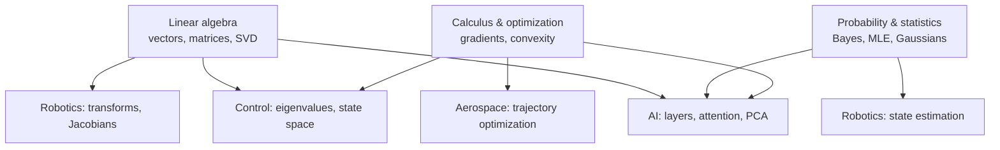

# Mathematics

> **Scope** — The mathematical toolkit that every other topic in this knowledge base borrows: linear algebra for structure, probability for uncertainty, and calculus and optimization for change and improvement.

## Visual summary

## Notes

| Note | Status | One-line summary |
|---|---|---|
| [Linear algebra](linear-algebra.md) | growing | Matrices as maps, eigenvalues, SVD, least squares and PCA |
| [Probability & statistics](probability-and-statistics.md) | growing | Bayes' rule, expectation, MLE and how loss functions arise |
| [Calculus & optimization](calculus-and-optimization.md) | growing | Gradients, Hessians, gradient descent, convexity and constraints |

## Suggested reading order

Linear algebra and calculus can be learned in parallel; read probability once comfortable with both. All three before the [AI](../ai/index.md) notes if the notation is new.

## Related topics

- [AI](../ai/index.md), [Robotics](../robotics/index.md), [Control systems](../control-systems/index.md) — the main consumers.
- [Physics](../physics/index.md) — where much of this mathematics originated.
