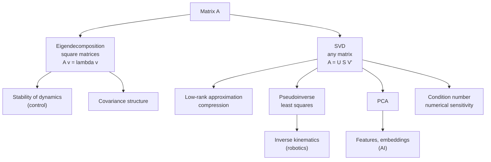

# Linear Algebra

> **TL;DR** — A matrix is a linear map. Eigenvectors are the directions it only stretches, the singular value decomposition (SVD) is the universal way to see what any matrix does, and least squares is how you solve overdetermined problems. Almost every engineering and ML algorithm rests on these.

## Why it matters

Neural-network layers are matrix multiplies, robot kinematics is composed rotations, control stability is the eigenvalues of $A$, and PCA is an SVD. Fluency here pays off in every other topic.

## Core ideas

### Vectors, norms and projections

- Dot product: $a\cdot b = \sum_i a_i b_i = \|a\|\|b\|\cos\theta$. Orthogonal vectors have zero dot product.
- Common norms: $\|x\|_2 = \sqrt{\sum x_i^2}$ (Euclidean), $\|x\|_1 = \sum|x_i|$ (promotes sparsity).
- Projection of $b$ onto $a$: $\dfrac{a\cdot b}{a\cdot a}\,a$.

### Matrices as linear maps

$A\in\mathbb{R}^{m\times n}$ maps $\mathbb{R}^n\to\mathbb{R}^m$. Multiplication composes maps (order matters: $AB \ne BA$ in general). Key properties:

| Concept | Meaning |
|---|---|
| Rank | Dimension of the output space actually reached |
| Determinant (square) | Signed volume scaling; zero means singular (not invertible) |
| Inverse $A^{-1}$ | Exists iff $\det A \ne 0$; avoid forming it, solve $Ax=b$ instead |
| Transpose | $(AB)^\top = B^\top A^\top$ |
| Orthogonal $Q$ | $Q^\top Q = I$; preserves lengths and angles; rotations have $\det = +1$ |

### Eigenvalues and eigenvectors

$$
A v = \lambda v
$$

For a **symmetric** matrix, eigenvalues are real, eigenvectors can be chosen orthogonal, and $A = Q\Lambda Q^\top$. Uses: stability of $\dot x = Ax$ (all $\operatorname{Re}\lambda<0$), vibration modes, covariance structure.

### Singular value decomposition

Every matrix factors as

$$
A = U\Sigma V^\top
$$

with orthogonal $U, V$ and non-negative singular values $\sigma_1 \ge \sigma_2 \ge \cdots$ on the diagonal of $\Sigma$. Consequences:

- **Rank-$k$ approximation:** keeping the top $k$ singular values gives the best rank-$k$ approximation in the Frobenius and spectral norms (Eckart-Young theorem).
- **Pseudoinverse:** $A^{+} = V\Sigma^{+}U^\top$.
- **Condition number:** $\kappa(A) = \sigma_{max}/\sigma_{min}$; large $\kappa$ means solutions are sensitive to noise.
- **Singular robot configurations** are where a Jacobian's smallest singular value goes to zero (see [Kinematics](../robotics/kinematics.md)).

### Least squares

For overdetermined $Ax \approx b$, minimize $\|Ax - b\|_2^2$. The solution satisfies the **normal equations**

$$
A^\top A\, x = A^\top b
$$

Numerically, prefer QR or SVD-based solvers over forming $A^\top A$, which squares the condition number.

### PCA via SVD

Center the data matrix $X$ ($n$ samples by $d$ features) and compute $X = U\Sigma V^\top$. Columns of $V$ are the principal directions; the variance explained by component $i$ is proportional to $\sigma_i^2$.

## Diagram



## Worked examples

**Eigenvalues by hand.** $A = \begin{bmatrix}2&1\\1&2\end{bmatrix}$ has characteristic polynomial $(2-\lambda)^2 - 1 = 0$, so $\lambda = 3$ with eigenvector $(1,1)/\sqrt2$ and $\lambda = 1$ with $(1,-1)/\sqrt2$. The matrix stretches by 3 along the diagonal and by 1 across it.

**Low-rank structure with SVD.** Build a $6\times5$ matrix that is secretly rank 2, add a little noise, and let the singular values reveal it:

```python
import numpy as np

rng = np.random.default_rng(0)
A = rng.normal(size=(6, 2)) @ rng.normal(size=(2, 5)) + 0.01 * rng.normal(size=(6, 5))

U, S, Vt = np.linalg.svd(A, full_matrices=False)
print("singular values:", np.round(S, 3))

A2 = (U[:, :2] * S[:2]) @ Vt[:2]                  # best rank-2 approximation
print("relative error:", np.linalg.norm(A - A2) / np.linalg.norm(A))
```

Running it gives singular values of roughly $[4.98,\ 2.17,\ 0.02,\ 0.02,\ 0.005]$: two large values and a sharp drop, so the effective rank is 2, and the rank-2 approximation has a relative error of about 0.5%. The gap in the spectrum is the signal you look for when choosing how many components to keep.

## Pitfalls

- **Computing $A^{-1}$ explicitly:** slower and less accurate than solving the system.
- **Forgetting that matrix multiplication does not commute,** especially when composing rotations.
- **Normal equations on ill-conditioned problems:** use `np.linalg.lstsq` or QR.
- **Applying PCA without centering or scaling** features with different units.
- **Assuming eigenvectors are orthogonal** for non-symmetric matrices (they generally are not).

## Related

- [Neural networks & backprop](../ai/neural-networks-and-backprop.md) — layers as matrix multiplies.
- [State space & LQR](../control-systems/state-space-and-lqr.md) — eigenvalues and rank tests.
- [Kinematics](../robotics/kinematics.md) — rotations, Jacobians and singularities.
- [Probability & statistics](probability-and-statistics.md) — covariance matrices and Gaussians.

## Further reading

- Strang, *Introduction to Linear Algebra*; his MIT OpenCourseWare lectures are excellent.
- Deisenroth, Faisal, Ong, *Mathematics for Machine Learning* (free online).
