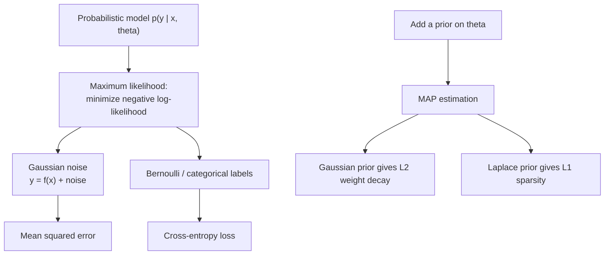

# Probability and Statistics

> **TL;DR** — Probability describes uncertainty; statistics infers models from data. Bayes' rule updates beliefs, maximum likelihood turns "fit a model" into "minimize a loss," and the Gaussian shows up everywhere because of the central limit theorem.

## Why it matters

Sensors are noisy, data are finite and predictions are uncertain. The probabilistic view explains why mean squared error and cross-entropy are the standard losses, how Kalman filters work, and why you should distrust a result from a small sample.

## Core ideas

### Basics

- Conditional probability: $P(A\mid B) = P(A\cap B)/P(B)$.
- Independence: $P(A\cap B) = P(A)P(B)$.
- Expectation and variance: $\mathbb{E}[X]$, $\operatorname{Var}(X) = \mathbb{E}[X^2] - \mathbb{E}[X]^2$. Expectation is linear; variance of independent sums adds.
- **Bayes' rule:**

$$
P(\theta\mid D) = \frac{P(D\mid\theta)\,P(\theta)}{P(D)}
$$

posterior $\propto$ likelihood $\times$ prior.

### Common distributions

| Distribution | Models | Mean | Variance |
|---|---|---|---|
| Bernoulli($p$) | One yes/no trial | $p$ | $p(1-p)$ |
| Binomial($n,p$) | Successes in $n$ trials | $np$ | $np(1-p)$ |
| Poisson($\lambda$) | Event counts in an interval | $\lambda$ | $\lambda$ |
| Uniform($a,b$) | Equal likelihood on an interval | $(a+b)/2$ | $(b-a)^2/12$ |
| Exponential($\lambda$) | Waiting time between events | $1/\lambda$ | $1/\lambda^2$ |
| Gaussian($\mu,\sigma^2$) | Sums of many small effects, measurement noise | $\mu$ | $\sigma^2$ |

Gaussian density: $p(x) = \dfrac{1}{\sqrt{2\pi}\sigma}\exp\!\left(-\dfrac{(x-\mu)^2}{2\sigma^2}\right)$.

### Two theorems that justify statistics

- **Law of large numbers:** sample averages converge to the true mean.
- **Central limit theorem:** the average of many independent, finite-variance variables is approximately Gaussian, with standard deviation $\sigma/\sqrt{n}$. This is why error bars shrink only as $1/\sqrt{n}$: 4 times the data halves the uncertainty.

### Maximum likelihood and MAP

Choose the parameters that make the observed data most probable:

$$
\hat\theta_{MLE} = \arg\max_\theta \sum_i \log p(x_i\mid\theta), \qquad
\hat\theta_{MAP} = \arg\max_\theta \Big[\sum_i \log p(x_i\mid\theta) + \log p(\theta)\Big]
$$

### Entropy and KL divergence

$$
H(p) = -\sum_x p(x)\log p(x), \qquad
D_{KL}(p\,\|\,q) = \sum_x p(x)\log\frac{p(x)}{q(x)} \ge 0
$$

Cross-entropy $H(p,q) = H(p) + D_{KL}(p\|q)$, so minimizing cross-entropy over $q$ is the same as minimizing KL divergence from the data distribution.

## Diagram

Where common loss functions come from:

## Worked example: the base-rate trap

A disease has 1% prevalence. A test has 90% sensitivity ($P(+\mid D)=0.90$) and 95% specificity ($P(-\mid \neg D)=0.95$, so a 5% false-positive rate). You test positive. What is $P(D\mid +)$?

$$
P(D\mid+) = \frac{0.90\times0.01}{0.90\times0.01 + 0.05\times0.99} = \frac{0.009}{0.0585} \approx 0.154
$$

Only about 15% despite a "90% accurate" test, because healthy people vastly outnumber sick ones. Ignoring the prior ("base-rate neglect") is among the most common probabilistic mistakes.

## Pitfalls

- **Base-rate neglect** (above) and **confusing $P(A\mid B)$ with $P(B\mid A)$**.
- **Assuming independence** without checking; correlated errors make averages far less informative than $\sigma/\sqrt{n}$ suggests.
- **Multiple comparisons and p-hacking:** test enough hypotheses and some will look significant by chance; correct for it or pre-register.
- **Misreading intervals:** a 95% confidence interval is a statement about the procedure's long-run coverage, not "95% probability the parameter is in this range" (that is a credible interval from a Bayesian analysis).
- **Correlation is not causation;** confounders and selection effects need design, not more data.
- **Gaussian assumption on heavy-tailed data:** outliers dominate; consider robust statistics.

## Related

- [Machine learning fundamentals](../ai/machine-learning-fundamentals.md) — losses and generalization.
- [State estimation](../robotics/state-estimation.md) — Bayes filters and Kalman filters.
- [Reinforcement learning](../ai/reinforcement-learning.md) — expectations over trajectories.
- [Linear algebra](linear-algebra.md) — covariance matrices and multivariate Gaussians.

## Further reading

- Wasserman, *All of Statistics*.
- Bishop, *Pattern Recognition and Machine Learning* — probabilistic view of ML.
