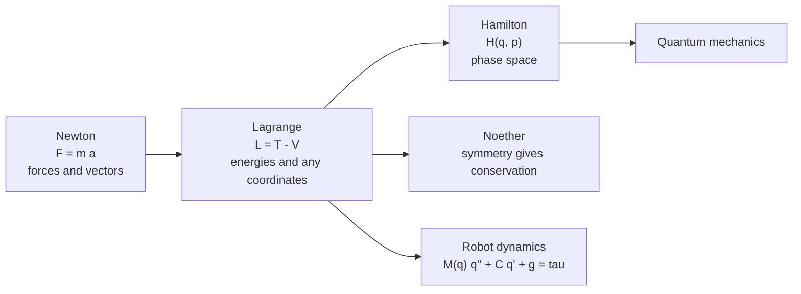

# Classical Mechanics

> **TL;DR** — Newton's laws say how forces change motion. Lagrangian mechanics reaches the same equations from energy and works in any coordinates, which makes it the method of choice for robots and spacecraft. Noether's theorem ties each symmetry to a conserved quantity.

## Why it matters

Robot arms, drones, rockets and vehicles are all mechanical systems. Their controllers are built on models derived from these principles; if the model is wrong, the controller is tuned against fiction.

## Core ideas

### Newtonian mechanics

$$
\vec F = \frac{d\vec p}{dt} = m\vec a, \qquad W = \int \vec F\cdot d\vec r, \qquad \text{Work-energy: } W_{net} = \Delta KE
$$

A **conservative** force (gravity, ideal spring) has a potential energy $V$ with $\vec F = -\nabla V$, and total energy $E = T + V$ is conserved.

### Lagrangian mechanics

Choose **generalized coordinates** $q_i$ that capture the degrees of freedom (joint angles, not Cartesian positions). With kinetic energy $T$ and potential energy $V$, define $\mathcal{L} = T - V$. Motion satisfies the Euler-Lagrange equations:

$$
\frac{d}{dt}\frac{\partial \mathcal{L}}{\partial \dot q_i} - \frac{\partial \mathcal{L}}{\partial q_i} = Q_i
$$

where $Q_i$ are non-conservative generalized forces (motor torques, friction). For a robot arm this produces the standard manipulator equation

$$
M(q)\,\ddot q + C(q,\dot q)\,\dot q + g(q) = \tau
$$

with mass matrix $M$, Coriolis/centrifugal terms $C$, gravity $g$ and joint torques $\tau$.

### Hamiltonian view

With momenta $p_i = \partial\mathcal{L}/\partial\dot q_i$ and $H = \sum p_i \dot q_i - \mathcal{L}$, motion follows $\dot q_i = \partial H/\partial p_i$, $\dot p_i = -\partial H/\partial q_i$. For most systems $H$ is the total energy, and this form underlies phase-space analysis and the bridge to quantum mechanics.

### Noether's theorem

| Symmetry of the Lagrangian | Conserved quantity |
|---|---|
| Time translation | Energy |
| Space translation | Linear momentum |
| Rotation | Angular momentum |

### Rigid-body rotation

Euler's equations in the body frame, with inertia tensor $I$, angular velocity $\omega$ and torque $\tau$:

$$
I\dot\omega + \omega \times (I\omega) = \tau
$$

The cross-term is why a spinning body can tumble even with zero torque, and why spacecraft attitude control is not simply "three independent PIDs."

## Diagram

## Worked example: the simple pendulum

Mass $m$ on a massless rod of length $l$, angle $\theta$ from vertical, pivot at height zero:

$$
T = \tfrac12 m l^2\dot\theta^2, \quad V = -mgl\cos\theta, \quad
\mathcal{L} = \tfrac12 m l^2\dot\theta^2 + mgl\cos\theta
$$

Euler-Lagrange: $m l^2\ddot\theta + m g l\sin\theta = 0$, so

$$
\ddot\theta = -\frac{g}{l}\sin\theta
$$

For small angles, $\sin\theta\approx\theta$ and the period is $T_0 = 2\pi\sqrt{l/g}$. For $l = 1\ \text{m}$, $T_0 \approx 2.006\ \text{s}$. The small-angle formula is not exact: at an amplitude of $60^\circ$ the true period is about $7.3\%$ longer, because the restoring force $\sin\theta$ falls below $\theta$ at large angles.

## Pitfalls

- **Mixing coordinate systems and frames** (inertial vs rotating): fictitious forces (Coriolis, centrifugal) appear only in non-inertial frames.
- **Treating the small-angle linearization as valid everywhere**; check the amplitude.
- **Forgetting constraints:** use generalized coordinates or Lagrange multipliers rather than adding constraint forces by hand.
- **Unit mistakes:** keep SI throughout and convert degrees to radians before using trigonometric derivatives.

## Related

- [Kinematics](../robotics/kinematics.md) — the geometry that the mass matrix $M(q)$ is built from.
- [PID control](../control-systems/pid-control.md) and [State space & LQR](../control-systems/state-space-and-lqr.md) — controlling the dynamics derived here.
- [Orbital mechanics](../aerospace/orbital-mechanics.md) — Newtonian gravity in the two-body problem.
- [Calculus & optimization](../mathematics/calculus-and-optimization.md) — the calculus of variations behind Euler-Lagrange.

## Further reading

- Taylor, *Classical Mechanics* — clear and thorough.
- Goldstein, Poole, Safko, *Classical Mechanics* — graduate-level reference.
