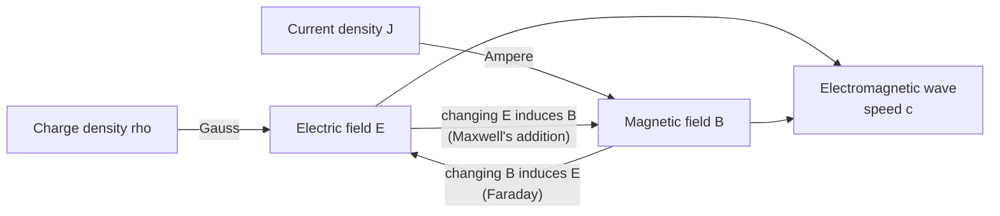

# Electromagnetism

> **TL;DR** — Four equations (Maxwell's) describe how charges and currents create electric and magnetic fields, and how changing fields create each other. Motors, generators, transformers, antennas and light are all consequences.

## Why it matters

Electromagnetism is the physics under every electrical machine and every wireless link. Even if you only use circuit theory day to day, knowing the field picture explains inductance, motor behavior, EMI and why high-frequency signals behave differently.

## Core ideas

### Maxwell's equations (SI, differential form)

| Equation | Statement |
|---|---|
| $\nabla\cdot\vec E = \rho/\varepsilon_0$ | Gauss's law: charge produces electric field |
| $\nabla\cdot\vec B = 0$ | No magnetic monopoles |
| $\nabla\times\vec E = -\partial\vec B/\partial t$ | Faraday's law: changing magnetic field induces electric field |
| $\nabla\times\vec B = \mu_0\vec J + \mu_0\varepsilon_0\,\partial\vec E/\partial t$ | Ampère-Maxwell: current and changing electric field produce magnetic field |

Combining the last two gives waves travelling at

$$
c = \frac{1}{\sqrt{\mu_0\varepsilon_0}} \approx 2.998\times10^{8}\ \text{m/s}
$$

so light is an electromagnetic wave.

### Force on charges

$$
\vec F = q\big(\vec E + \vec v\times\vec B\big)
$$

On a straight current-carrying wire of length $L$ in a perpendicular field: $F = BIL$.

### Induction

Faraday's law in circuit form: $\mathcal{E} = -\dfrac{d\Phi}{dt}$, with the minus sign (Lenz's law) meaning the induced current opposes the change in flux. An inductor stores energy in its magnetic field:

$$
v = L\frac{di}{dt}, \qquad E = \tfrac12 L i^2
$$

### DC motor in two relations

A brushed DC motor couples the electrical and mechanical sides through two constants (equal in SI units):

$$
\tau = k_t\, I \quad\text{(torque from current)}, \qquad e = k_e\,\omega \quad\text{(back-EMF from speed)}
$$

At steady state, $V = IR + k_e\omega$. This is why motor speed settles where back-EMF nearly cancels the supply, and why stall current $V/R$ is the worst case for heating.

### Skin effect

At high frequency, current crowds toward a conductor's surface within the **skin depth**

$$
\delta = \sqrt{\frac{2\rho}{\omega\mu}}
$$

For copper this is about 8.4 mm at 60 Hz but only about 65 µm at 1 MHz, so thick solid conductors waste material at RF; litz wire and flat traces are used instead.

## Diagram

How the fields generate each other:

## Worked example

A 0.10 m straight conductor carrying 2.0 A sits perpendicular to a 0.50 T field:

$$
F = BIL = 0.50 \times 2.0 \times 0.10 = 0.10\ \text{N}
$$

A motor winding is many such conductors in a loop arrangement, which is how torque is built up. Doubling the current doubles the force, which is exactly the $\tau = k_t I$ relation above.

## Pitfalls

- **Sign of induced EMF:** the minus sign is physical (energy conservation), not decoration.
- **Right-hand rule errors:** $\vec v\times\vec B$ ordering matters; verify direction with a quick sketch.
- **Treating wires as ideal at high frequency:** every wire has inductance and every pair of conductors has capacitance; at speed these dominate (ground bounce, crosstalk).
- **Inductive kickback:** interrupting current through a coil produces a large voltage spike $L\,di/dt$; add a flyback diode when switching motors and relays.

## Related

- [Circuit fundamentals](../electronics/circuit-fundamentals.md) — lumped-element simplification of these fields.
- [Quantum & semiconductors](quantum-and-semiconductors.md) — where the electrons in the wires come from and how devices control them.
- [PID control](../control-systems/pid-control.md) — closing the loop around motors.
- [Thermodynamics](thermodynamics.md) — where $I^2R$ losses end up.

## Further reading

- Griffiths, *Introduction to Electrodynamics*.
- Feynman, *The Feynman Lectures on Physics*, Volume II (free online).
