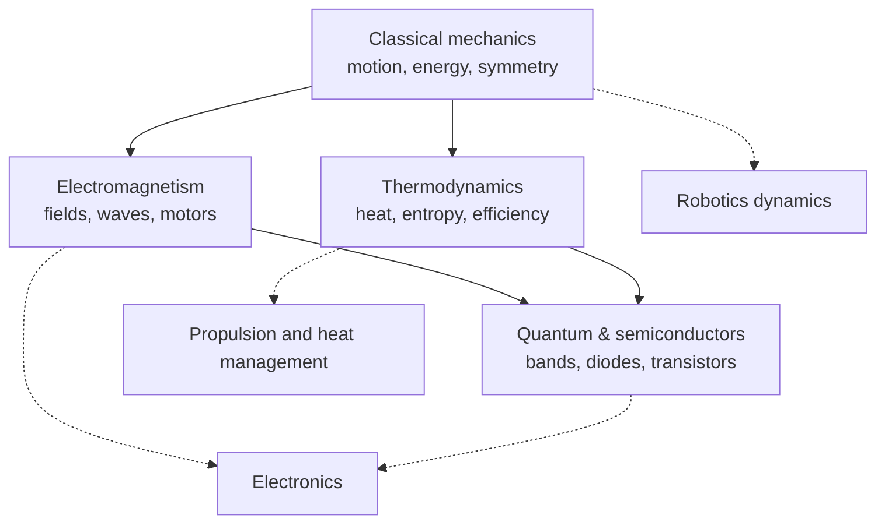

# Physics

> **Scope** — The physical laws engineers lean on most: how things move, how heat flows, how electric and magnetic fields behave, and how quantum mechanics produces the semiconductors that all computing is built on.

## Visual summary

## Notes

| Note | Status | One-line summary |
|---|---|---|
| [Classical mechanics](classical-mechanics.md) | growing | Newton, Lagrange, conservation laws and the pendulum |
| [Thermodynamics](thermodynamics.md) | growing | The four laws, Carnot limits and heat transfer for engineers |
| [Electromagnetism](electromagnetism.md) | growing | Maxwell's equations, induction, motors and skin depth |
| [Quantum & semiconductors](quantum-and-semiconductors.md) | growing | From wave functions to bands, diodes and transistors |

## Suggested reading order

Classical mechanics, then Electromagnetism, then Quantum & semiconductors. Thermodynamics can be read at any point after mechanics.

## Related topics

- [Electronics](../electronics/index.md) — applied electromagnetism and semiconductor devices.
- [Aerospace](../aerospace/index.md) — mechanics and thermodynamics applied to flight.
- [Mathematics](../mathematics/index.md) — calculus and linear algebra are the working language of physics.
