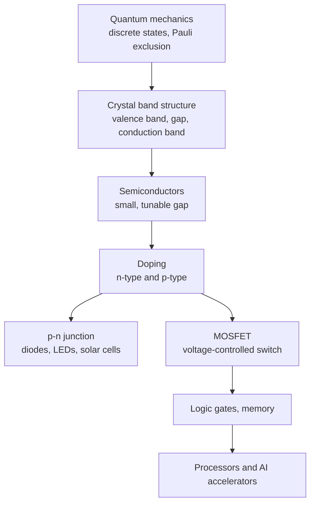

# Quantum Mechanics and Semiconductors

> **TL;DR** — Electrons in a crystal occupy energy bands separated by gaps. A semiconductor's small, tunable gap lets us control conduction with doping and voltage, and that control is the diode and the transistor, the building blocks of all digital electronics and AI hardware.

## Why it matters

Quantum mechanics is why solids have bands at all, why chips are shrinking toward limits (tunneling leakage), and why photodiodes, LEDs and lasers work. Even a high-level picture helps you read datasheets: forward voltage, leakage current and threshold voltage all trace back to band structure.

## Core ideas

### Quantum basics

- **Quantization:** energies of bound systems are discrete; photons carry $E = hf$ with $h = 6.626\times10^{-34}\ \text{J·s}$.
- **Wave-particle duality:** matter has wavelength $\lambda = h/p$.
- **Schrödinger equation:** $i\hbar\,\partial\psi/\partial t = \hat H\psi$. The probability of finding a particle is $|\psi|^2$ (Born rule).
- **Uncertainty:** $\Delta x\,\Delta p \ge \hbar/2$.
- **Tunneling:** a particle has a non-zero probability to cross a barrier it classically could not. This is exploited in flash memory and is a leakage problem in tiny transistors.

### From atoms to bands

When $N$ atoms form a crystal, their discrete levels broaden into **bands**. What matters is the band gap $E_g$ between the filled valence band and the empty conduction band:

| Material class | Band structure | Example gaps (about 300 K) |
|---|---|---|
| Metal | Bands overlap or are partly filled | None |
| Semiconductor | Small gap | Ge 0.67 eV, Si 1.12 eV, GaAs 1.42 eV |
| Insulator | Large gap | Over about 4 eV; diamond about 5.5 eV |

Wide-gap semiconductors (SiC, GaN) tolerate higher voltages and temperatures, which is why they are used in power electronics.

### Doping and the p-n junction

- **n-type:** add donor atoms (phosphorus, arsenic) to supply extra electrons.
- **p-type:** add acceptor atoms (boron) to create mobile holes.

Joining the two forms a depletion region with a built-in potential. Forward bias shrinks the barrier and current rises exponentially; reverse bias widens it and only a tiny leakage current flows.

### The diode equation

$$
I = I_s\left(e^{V/(nV_T)} - 1\right), \qquad V_T = \frac{kT}{q} \approx 25.85\ \text{mV at 300 K}
$$

with saturation current $I_s$ and ideality factor $n$ (between 1 and 2). A silicon diode "turns on" around 0.6 to 0.7 V because the exponential becomes steep there, not because of a hard threshold.

### The MOSFET

A gate voltage above a threshold $V_T$ attracts carriers to form a conducting channel between source and drain, so a voltage controls a current with almost no gate current. In the simple long-channel saturation model $I_D \approx \tfrac12 k\,(V_{GS} - V_T)^2$. Arranged as complementary pairs (CMOS), they draw significant current only while switching, which is why CMOS dominates digital logic.

## Diagram

## Worked example

A diode with $I_s = 10^{-12}\ \text{A}$, $n = 1$ at 300 K and $V = 0.60\ \text{V}$:

$$
I = 10^{-12}\left(e^{0.60/0.02585} - 1\right) \approx 10^{-12}\times 1.2\times10^{10} \approx 12\ \text{mA}
$$

Raising the voltage by only $V_T\ln 10 \approx 60\ \text{mV}$ multiplies the current by 10 (so about 0.66 V gives about 120 mA). That steepness is why a diode's forward voltage barely changes over a wide current range, and also why it needs a series resistor to limit current.

## Pitfalls

- **Treating the diode as an ideal 0.7 V battery** in precise designs; the drop depends on current and temperature (it falls roughly 2 mV per °C).
- **Forgetting temperature dependence:** $V_T$, $I_s$ and leakage all change with temperature; leakage roughly doubles every 10 °C.
- **Mixing up units:** band gaps in eV; 1 eV $= 1.602\times10^{-19}$ J.
- **Static discharge:** MOSFET gates are thin oxides that can be destroyed by electrostatic discharge.

## Related

- [Electromagnetism](electromagnetism.md) — fields that move charge through these devices.
- [Circuit fundamentals](../electronics/circuit-fundamentals.md) — using diodes and transistors in circuits.
- [Microcontrollers & buses](../electronics/microcontrollers-and-buses.md) — CMOS logic levels and GPIO behavior.
- [Thermodynamics](thermodynamics.md) — Boltzmann statistics set the $e^{V/V_T}$ behavior and thermal limits.

## Further reading

- Neamen, *Semiconductor Physics and Devices*.
- Griffiths, *Introduction to Quantum Mechanics*.
