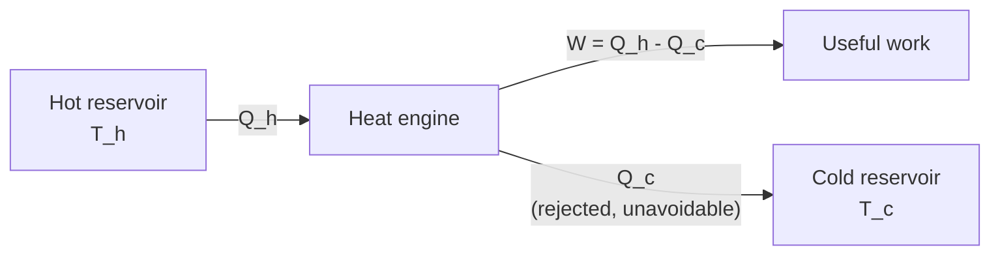
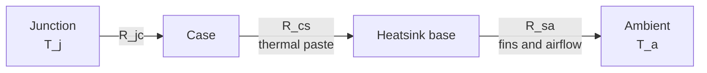

# Thermodynamics and Heat Transfer

> **TL;DR** — Energy is conserved (first law), but not all of it can be turned into work (second law). Heat moves by conduction, convection and radiation, and in electronics and engines the practical question is nearly always "where does the heat go, and how hot does it get?"

## Why it matters

Every processor, motor, battery and engine is limited by heat. The Carnot limit sets what is theoretically possible; thermal resistance models tell you whether a chip will survive on your desk.

## Core ideas

### The laws

| Law | Statement | Consequence |
|---|---|---|
| Zeroth | Two systems each in equilibrium with a third are in equilibrium with each other | Temperature is well defined |
| First | $\Delta U = Q - W$ | Energy is conserved; heat added minus work done by the system changes internal energy |
| Second | The entropy of an isolated system never decreases | Heat does not flow spontaneously from cold to hot; no engine is 100% efficient |
| Third | Entropy approaches a constant as $T \to 0$ | Absolute zero cannot be reached in a finite number of steps |

Entropy change for a reversible heat transfer: $\Delta S = Q_{rev}/T$.

### Ideal gas

$$
PV = nRT, \qquad R \approx 8.314\ \text{J mol}^{-1}\text{K}^{-1}
$$

Temperature must be absolute (kelvin).

### Heat engines and the Carnot limit

An engine takes heat $Q_h$ from a hot reservoir at $T_h$, rejects $Q_c$ to a cold reservoir at $T_c$, and delivers work $W = Q_h - Q_c$. No engine operating between those temperatures can beat

$$
\eta_{Carnot} = 1 - \frac{T_c}{T_h}
$$

Refrigerators and heat pumps run the cycle backwards; their coefficients of performance are bounded similarly.

### Three modes of heat transfer

| Mode | Law | Key parameter |
|---|---|---|
| Conduction | $\dot Q = -kA\,\dfrac{dT}{dx}$; for a flat wall $\dot Q = \dfrac{kA\,\Delta T}{L}$ | Thermal conductivity $k$ (W/m·K) |
| Convection | $\dot Q = hA\,\Delta T$ | Heat-transfer coefficient $h$ (W/m²·K) |
| Radiation | $\dot Q = \varepsilon\sigma A\,T^4$ | Emissivity $\varepsilon$; $\sigma = 5.670\times10^{-8}\ \text{W m}^{-2}\text{K}^{-4}$ |

### Thermal resistance networks

Steady-state heat flow behaves like current in a resistor network, with $\Delta T$ as voltage and thermal resistance $R_\theta$ (K/W or °C/W) as resistance:

$$
T_j = T_a + P \sum R_\theta
$$

Resistances in the heat path (junction to case, case to heatsink through thermal paste, heatsink to ambient) add in series.

## Diagram

Thermal path of a chip, analogous to a series circuit:

## Worked examples

**Carnot limit.** An engine running between $T_h = 600\ \text{K}$ and $T_c = 300\ \text{K}$ has $\eta_{max} = 1 - 300/600 = 50\%$. Real engines achieve a fraction of this because of friction, finite-rate heat transfer and irreversibility.

**Will the chip overheat?** A regulator dissipates $P = 5\ \text{W}$. Thermal resistances: junction-to-case $2\ \text{°C/W}$, paste $0.5\ \text{°C/W}$, heatsink-to-ambient $9.5\ \text{°C/W}$, total $12\ \text{°C/W}$. With ambient at $25\ \text{°C}$:

$$
T_j = 25 + 5 \times 12 = 85\ \text{°C}
$$

If the datasheet maximum junction temperature is $125\ \text{°C}$, there is a $40\ \text{°C}$ margin. In a sealed enclosure the effective ambient might be $50\ \text{°C}$, which would bring the junction to $110\ \text{°C}$, a far thinner margin.

## Pitfalls

- **Using Celsius in $T^4$ or Carnot formulas.** Convert to kelvin first.
- **Confusing heat and temperature:** heat is energy in transit; temperature is a state variable.
- **Ignoring radiation** at high temperatures (it scales as $T^4$) and ignoring convection limits in sealed enclosures.
- **Quoting a Carnot efficiency as an achievable target** rather than an upper bound.
- **Forgetting that component datasheets give $R_\theta$ for specific mounting conditions** (board copper area, airflow).

## Related

- [Electromagnetism](electromagnetism.md) — resistive heating $P = I^2R$ is where electrical power becomes heat.
- [Circuit fundamentals](../electronics/circuit-fundamentals.md) — power dissipation in circuits.
- [Rocket equation & staging](../aerospace/rocket-equation-and-staging.md) — propulsion is a heat engine producing exhaust momentum.
- [Classical mechanics](classical-mechanics.md) — the work-energy foundation.

## Further reading

- Schroeder, *An Introduction to Thermal Physics*.
- Incropera & DeWitt, *Fundamentals of Heat and Mass Transfer*.
