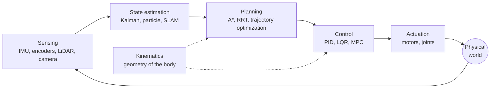

# Robotics

> **Scope** — How machines sense, decide and move in the physical world: system architecture, the geometry of motion, estimating state from noisy sensors, and planning collision-free paths.

## Visual summary

## Notes

| Note | Status | One-line summary |
|---|---|---|
| [Sense-plan-act architecture](sense-plan-act.md) | growing | The standard layered view of a robot, its sensors, and ROS 2 vocabulary |
| [Kinematics](kinematics.md) | growing | Forward and inverse kinematics, the Jacobian and singularities, with runnable code |
| [State estimation](state-estimation.md) | growing | Kalman filter, particle filter and the structure of SLAM |
| [Motion planning](motion-planning.md) | growing | Configuration space, A*, sampling-based planners and when to use each |

## Suggested reading order

Architecture → Kinematics → State estimation → Motion planning, then dip into [Control systems](../control-systems/index.md) for the layer that turns plans into motor commands.

## Related topics

- [Control systems](../control-systems/index.md) — closing the loop around actuators.
- [Electronics](../electronics/index.md) — sensors, motor drivers and buses.
- [AI](../ai/index.md) — learned perception and policies.
- [Mathematics](../mathematics/index.md) — linear algebra and probability throughout.
