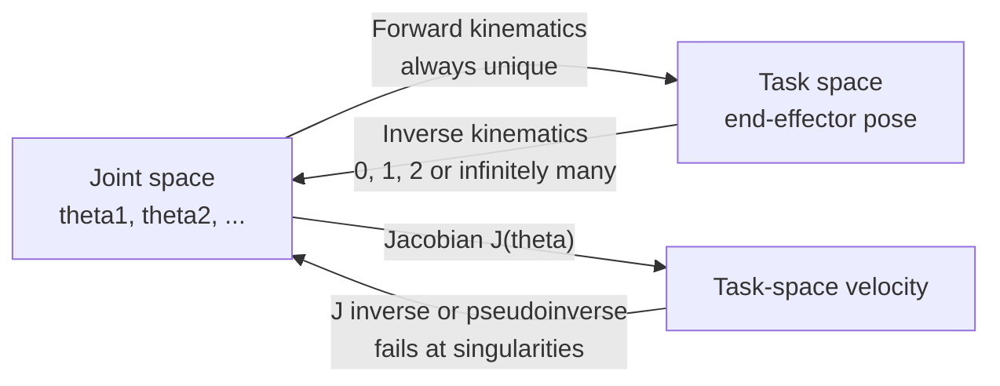

# Kinematics

> **TL;DR** — Forward kinematics maps joint angles to end-effector pose (easy, always has one answer). Inverse kinematics goes the other way (harder: zero, one or many answers). The Jacobian relates joint velocities to end-effector velocity and tells you where the arm loses mobility.

## Why it matters

Every manipulator and legged robot controller needs this geometry. Singularities, reachability limits and multiple IK solutions explain behavior that otherwise looks like a controller bug.

## Core ideas

### Forward kinematics (FK)

Chain rigid-body transforms from base to tool. In 3-D each link contributes a $4\times4$ homogeneous transform

$$
T = \begin{bmatrix} R & p \\ 0 & 1 \end{bmatrix}, \qquad T_{0\to n} = T_{0\to1}\,T_{1\to2}\cdots T_{n-1\to n}
$$

where $R \in SO(3)$ is a rotation and $p$ a translation. The Denavit-Hartenberg (DH) convention is one systematic way to assign link frames and parameters.

### Planar 2-link arm

Link lengths $l_1, l_2$, joint angles $\theta_1, \theta_2$:

$$
x = l_1\cos\theta_1 + l_2\cos(\theta_1+\theta_2), \qquad
y = l_1\sin\theta_1 + l_2\sin(\theta_1+\theta_2)
$$

### Inverse kinematics (IK)

For the same arm, by the law of cosines:

$$
\cos\theta_2 = \frac{x^2 + y^2 - l_1^2 - l_2^2}{2\,l_1 l_2}, \qquad
\theta_1 = \operatorname{atan2}(y, x) - \operatorname{atan2}\big(l_2\sin\theta_2,\; l_1 + l_2\cos\theta_2\big)
$$

- If $|\cos\theta_2| > 1$ the target is **unreachable**.
- Otherwise there are generally **two solutions**: "elbow-up" and "elbow-down" ($\theta_2$ of either sign).

For arms with more joints than task dimensions (redundant), IK has infinitely many solutions and is solved numerically, usually with Jacobian-based iteration.

### The Jacobian

$$
\dot p = J(\theta)\,\dot\theta
$$

For the 2-link arm, with $s_1=\sin\theta_1$, $c_{12}=\cos(\theta_1+\theta_2)$ and so on:

$$
J = \begin{bmatrix}
-l_1 s_1 - l_2 s_{12} & -l_2 s_{12} \\
 l_1 c_1 + l_2 c_{12} &  l_2 c_{12}
\end{bmatrix}, \qquad \det J = l_1 l_2 \sin\theta_2
$$

At $\theta_2 = 0$ (arm fully stretched) or $\theta_2 = \pi$ (folded) the determinant vanishes: a **singularity**. The arm cannot move its tip along the direction of the straight arm, and the inverse Jacobian blows up, demanding huge joint speeds.

The same $J$ gives static force mapping: joint torques $\tau = J^\top F$.

## Diagram



## Worked example

Arm with $l_1 = l_2 = 1$. Target $(x, y) = (1, 1)$.

$\cos\theta_2 = (1 + 1 - 1 - 1)/2 = 0 \Rightarrow \theta_2 = \pm 90^\circ$. Taking $+90^\circ$: $\theta_1 = \operatorname{atan2}(1,1) - \operatorname{atan2}(1, 1) = 0$. Check with FK: $x = 1\cdot 1 + 1\cdot\cos 90^\circ = 1$, $y = 0 + \sin 90^\circ = 1$. ✓

```python
import numpy as np

def fk(t1, t2, l1=1.0, l2=1.0):
    return np.array([l1*np.cos(t1) + l2*np.cos(t1+t2),
                     l1*np.sin(t1) + l2*np.sin(t1+t2)])

def ik(x, y, l1=1.0, l2=1.0, elbow_up=True):
    c2 = (x*x + y*y - l1*l1 - l2*l2) / (2*l1*l2)
    if abs(c2) > 1:
        raise ValueError("target out of reach")
    s2 = np.sqrt(1 - c2*c2) * (1 if elbow_up else -1)
    t2 = np.arctan2(s2, c2)
    t1 = np.arctan2(y, x) - np.arctan2(l2*s2, l1 + l2*c2)
    return t1, t2

for elbow in (True, False):
    t1, t2 = ik(1.2, 0.8, elbow_up=elbow)
    print(elbow, np.round(np.degrees([t1, t2]), 1), np.round(fk(t1, t2), 6))
```

Both solutions reproduce $(1.2, 0.8)$ under FK.

## Pitfalls

- **Angle wrapping:** $\theta$ and $\theta + 2\pi$ are the same pose; compare angles modulo $2\pi$.
- **Using `atan` instead of `atan2`** loses the quadrant.
- **Ignoring joint limits** when choosing among IK solutions; one solution is often infeasible.
- **Operating near singularities** with a naive inverse; use damped least squares $J^\top (J J^\top + \lambda^2 I)^{-1}$.
- **Euler angles:** gimbal lock. Prefer quaternions or rotation matrices internally.

## Related

- [Linear algebra](../mathematics/linear-algebra.md) — rotations, transforms, pseudoinverses and SVD (singularities are where singular values hit zero).
- [Motion planning](motion-planning.md) — planning happens in joint (configuration) space.
- [Classical mechanics](../physics/classical-mechanics.md) — dynamics builds on this geometry.

## Further reading

- Lynch & Park, *Modern Robotics: Mechanics, Planning, and Control* — screw-theory treatment, free online.
- Craig, *Introduction to Robotics: Mechanics and Control*.
