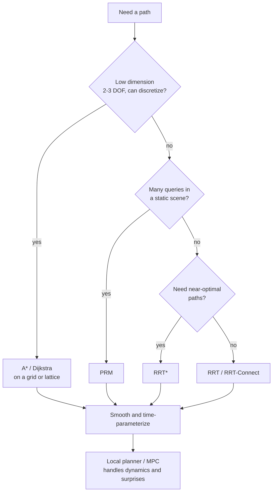

# Motion Planning

> **TL;DR** — Planning finds a collision-free path from start to goal. Work in *configuration space*, where the robot is a point; use graph search (A*) when you can discretize, sampling-based planners (RRT, PRM) when dimensions are high, and trajectory optimization when smoothness and dynamics matter.

## Why it matters

Choosing the wrong planner wastes weeks. Knowing what each guarantees, and where it struggles, tells you which one fits a given robot and environment.

## Core ideas

### Configuration space (C-space)

The **configuration** $q$ lists every degree of freedom (joint angles, or $x, y, \theta$ for a mobile robot). Obstacles in the workspace map to forbidden regions $C_{obs}$ in C-space. Planning then reduces to finding a continuous path from $q_{start}$ to $q_{goal}$ inside $C_{free}$.

### Graph search: Dijkstra and A*

On a grid or roadmap, A* expands nodes in order of

$$
f(n) = g(n) + h(n)
$$

where $g$ is the cost so far and $h$ estimates the remaining cost. If $h$ never overestimates (**admissible**) A* is optimal; if it is also **consistent**, no node is expanded twice. With $h = 0$ A* becomes Dijkstra.

### Sampling-based planners

| Planner | Idea | Guarantee |
|---|---|---|
| PRM (Probabilistic Roadmap) | Sample many free configurations, connect neighbors, then query the graph | Probabilistically complete; good for many queries in one static scene |
| RRT (Rapidly-exploring Random Tree) | Grow a tree from the start toward random samples | Probabilistically complete; fast single queries; paths are jagged and not optimal |
| RRT* | RRT plus rewiring to reduce cost | Asymptotically optimal |

*Probabilistically complete* means: if a path exists, the probability of finding it tends to 1 as samples grow.

### Trajectory optimization and local planning

Once a rough path exists, optimize a time-parameterized trajectory that minimizes time, energy or jerk subject to dynamics and constraints (CHOMP, TrajOpt, and model predictive control are examples). For mobile robots a **local planner** (for example the dynamic window approach) re-plans velocity commands at high rate to dodge obstacles the global map did not contain.

## Diagram

A decision guide.



## Worked example

A* on a 4-connected grid with unit step cost and the **Manhattan distance** heuristic $h = |x - x_g| + |y - y_g|$. On a 4-connected grid with unit moves this heuristic is admissible (any path needs at least that many steps) and consistent, so the first time the goal is popped its path is optimal.

```python
import heapq

def astar(grid, start, goal):
    """grid: list of strings, '#' = wall. Returns path length or None."""
    h = lambda p: abs(p[0] - goal[0]) + abs(p[1] - goal[1])
    open_heap = [(h(start), 0, start)]
    best = {start: 0}
    while open_heap:
        f, g, cur = heapq.heappop(open_heap)
        if cur == goal:
            return g
        if g > best[cur]:
            continue
        for dx, dy in ((1, 0), (-1, 0), (0, 1), (0, -1)):
            nx, ny = cur[0] + dx, cur[1] + dy
            if 0 <= ny < len(grid) and 0 <= nx < len(grid[0]) and grid[ny][nx] != "#":
                ng = g + 1
                if ng < best.get((nx, ny), 1e9):
                    best[(nx, ny)] = ng
                    heapq.heappush(open_heap, (ng + h((nx, ny)), ng, (nx, ny)))
    return None

maze = ["....#...",
        ".##.#.#.",
        ".#..#.#.",
        ".#.##.#.",
        ".#....#.",
        ".####.#.",
        "........"]
print(astar(maze, (0, 0), (7, 0)))
```

Running it prints `17`: the wall in the top row forces a detour down the left side and around, so the shortest path takes 17 steps instead of the Manhattan lower bound of 7.

## Pitfalls

- **Treating the robot as a point in the workspace:** inflate obstacles by the robot's footprint (or plan in C-space) or the robot will clip corners.
- **Inadmissible heuristics** make A* fast but silently suboptimal.
- **Narrow passages:** uniform sampling rarely lands in them, so RRT/PRM struggle; use bridge or Gaussian sampling strategies.
- **Kinodynamic constraints:** a geometric path may be impossible for a car-like robot with a minimum turning radius. Use kinodynamic planners or a smoothing step that respects dynamics.
- **Dynamic obstacles:** a static plan is stale the moment it is computed; replan or use reactive layers.

## Related

- [Kinematics](kinematics.md) — defines the configuration space for manipulators.
- [Reinforcement learning](../ai/reinforcement-learning.md) — learning-based alternative when no model is available.
- [Sense-plan-act architecture](sense-plan-act.md) — local vs global planning layers.
- [Calculus & optimization](../mathematics/calculus-and-optimization.md) — trajectory optimization is constrained optimization.

## Further reading

- LaValle, *Planning Algorithms*, free online.
- Karaman & Frazzoli, "Sampling-based algorithms for optimal motion planning" (2011) — introduces RRT* and PRM*.
