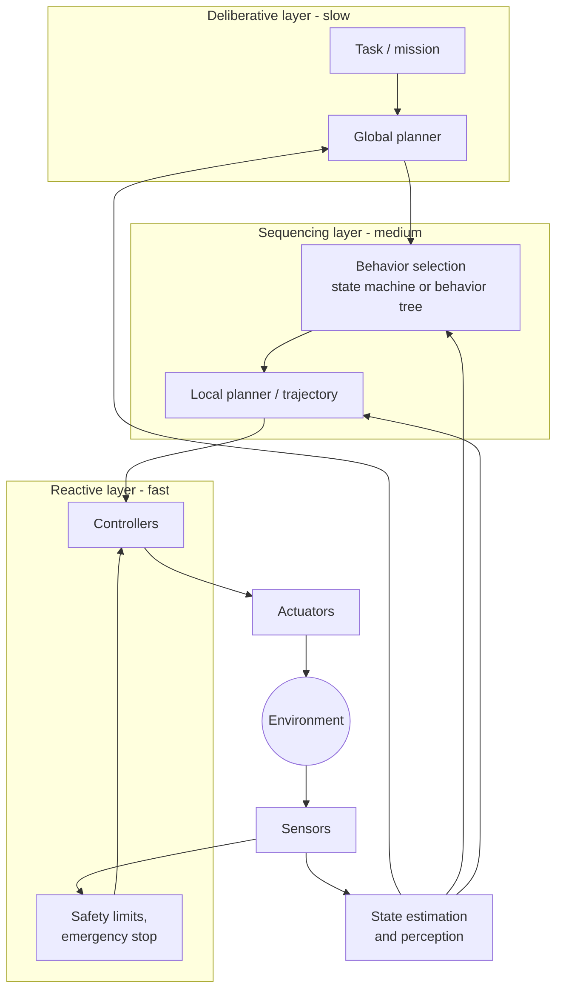

# Sense-Plan-Act Architecture

> **TL;DR** — Most robots are organized as a loop: sense the world, estimate state, plan what to do, control the actuators, repeat. Real systems run these layers at different rates and combine fast reactive behavior with slower deliberation.

## Why it matters

Before choosing algorithms, you need the system picture: what runs at 1 kHz, what runs at 10 Hz, and where noise and latency enter. Most integration bugs live at the boundaries between these layers.

## Core ideas

### The layers

| Layer | Question it answers | Typical rate | Examples |
|---|---|---|---|
| Actuation and low-level control | How do I make this joint or wheel do X? | 100 Hz to several kHz | PID current/velocity loops |
| State estimation | Where am I and what is the world like? | 10 to 500 Hz | [Kalman filters](state-estimation.md), visual odometry |
| Perception | What objects and free space are around me? | 5 to 60 Hz | Detection, segmentation, mapping |
| Planning | What path or trajectory achieves the goal? | 1 to 20 Hz | [A*, RRT](motion-planning.md), MPC |
| Task / behavior | What should I be doing? | Event-driven | State machines, behavior trees |

### Reactive, deliberative, hybrid

- **Reactive:** sensors map straight to actions (obstacle avoidance). Fast and robust, but short-sighted.
- **Deliberative:** build a model, plan globally, then execute. Optimal-ish, but slow and brittle when the model is wrong.
- **Hybrid (three-layer):** a deliberative planner sets goals, a sequencer picks behaviors, and a reactive layer keeps the robot safe in real time. This is the dominant pattern.

### Common sensors

| Sensor | Measures | Watch out for |
|---|---|---|
| Wheel/joint encoder | Rotation (proprioception) | Wheel slip, quantization, drift when integrated |
| IMU (gyro + accelerometer) | Angular rate and specific force | Gyro bias drift; accelerometer noise and vibration |
| LiDAR | Range to surfaces | Glass, sunlight, rain; sparse in the vertical direction |
| Camera | Appearance (rich, passive) | Lighting, motion blur, scale ambiguity for monocular |
| Depth camera | Per-pixel depth | Limited range, reflective surfaces |
| GNSS (GPS) | Global position | Multipath, blocked indoors, meter-level noise without correction |
| Force/torque | Contact loads | Temperature drift, calibration |

### Software middleware: ROS 2 vocabulary

ROS 2 provides a publish/subscribe layer (built on DDS) so components can be developed and swapped independently:

- **Node:** a process doing one job (a driver, a planner).
- **Topic:** a named, typed stream (`/scan`, `/cmd_vel`), many-to-many.
- **Service:** request/response call.
- **Action:** long-running goal with feedback and cancellation (for example "navigate to pose").
- **TF:** a tree of coordinate frames with timestamps, so transforms between sensor and body frames stay consistent.

## Diagram

## Worked example: a differential-drive rover

1. **Sense:** wheel encoders at 100 Hz, IMU at 200 Hz, LiDAR at 10 Hz.
2. **Estimate:** an extended Kalman filter fuses encoders and IMU for pose; LiDAR scan matching corrects drift.
3. **Plan:** a global planner finds a route on a map; a local planner picks velocity commands that avoid new obstacles.
4. **Control:** a velocity PID per wheel tracks the commanded wheel speeds.
5. **Safety:** a hardware watchdog cuts motor power if heartbeats stop.

## Pitfalls

- **Timestamps and latency:** fusing a camera frame with an IMU reading from a different instant produces errors that look like algorithm bugs. Timestamp at the source and use TF properly.
- **Rate mismatches:** commanding the low-level controller from a planner with jitter causes jerky motion; interpolate or buffer.
- **No independent safety layer:** never let a crash in high-level software leave motors energized.
- **Frame confusion:** mixing body, sensor and world frames is the most common source of "the robot goes the wrong way."

## Related

- [Kinematics](kinematics.md) — the geometry the controller must respect.
- [PID control](../control-systems/pid-control.md) — the workhorse low-level loop.
- [Microcontrollers & buses](../electronics/microcontrollers-and-buses.md) — how sensors and motor drivers connect.

## Further reading

- Siegwart, Nourbakhsh, Scaramuzza, *Introduction to Autonomous Mobile Robots*.
- The ROS 2 documentation (concepts section).
