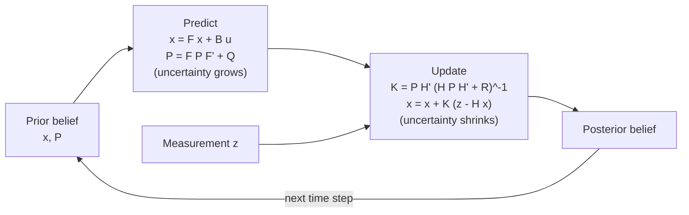

# State Estimation

> **TL;DR** — Sensors are noisy and models are imperfect. State estimators maintain a probability distribution over the robot's state: *predict* with the motion model (uncertainty grows), then *update* with a measurement (uncertainty shrinks). The Kalman filter does this optimally for linear-Gaussian systems.

## Why it matters

A controller can only act on what the robot believes. Good estimation turns cheap, noisy sensors into reliable pose, velocity and map information; bad estimation makes even a perfect controller fail.

## Core ideas

### The Bayes filter

Maintain a belief $bel(x_t) = p(x_t \mid z_{1:t}, u_{1:t})$:

1. **Predict:** push the belief through the motion model with control $u_t$.
2. **Update:** multiply by the measurement likelihood $p(z_t \mid x_t)$ and normalize.

Every practical filter is an approximation of this recursion.

### Kalman filter (KF)

Assumes linear dynamics $x_k = F x_{k-1} + B u_k + w$ with $w \sim \mathcal{N}(0, Q)$ and measurements $z_k = H x_k + v$ with $v \sim \mathcal{N}(0, R)$.

**Predict**

$$
\hat x_{k|k-1} = F\hat x_{k-1} + B u_k, \qquad
P_{k|k-1} = F P_{k-1} F^\top + Q
$$

**Update**

$$
K = P_{k|k-1} H^\top \big(H P_{k|k-1} H^\top + R\big)^{-1}
$$

$$
\hat x_k = \hat x_{k|k-1} + K\big(z_k - H\hat x_{k|k-1}\big), \qquad
P_k = (I - KH)\,P_{k|k-1}
$$

The Kalman gain $K$ balances trust: large $R$ (noisy sensor) gives small $K$ (trust the model); large $Q$ (poor model) gives large $K$ (trust the sensor).

### Beyond linear-Gaussian

| Filter | Idea | Use when |
|---|---|---|
| Extended KF (EKF) | Linearize nonlinear models with Jacobians at the current estimate | Mildly nonlinear systems (most IMU/GPS fusion) |
| Unscented KF (UKF) | Propagate a small set of sigma points through the nonlinearity | Stronger nonlinearity, no Jacobians needed |
| Particle filter | Represent the belief with weighted samples | Multi-modal beliefs, global localization |

### SLAM

Simultaneous Localization and Mapping estimates the robot trajectory *and* the map at once. A modern pipeline separates:

- **Front end:** turns raw sensor data into constraints (feature matches, scan-to-scan alignment, loop-closure detection).
- **Back end:** optimizes the whole pose graph so all constraints agree as well as possible (nonlinear least squares).

**Loop closure** (recognizing a previously visited place) is what removes accumulated drift.

## Diagram



## Worked example

Estimate a scalar position that is nearly constant ($F=1$, $H=1$, no control). Let $Q = 0.01$, $R = 1$, and start from $\hat x_0 = 0$, $P_0 = 1$. First measurement $z_1 = 1.0$.

- Predict: $\hat x = 0$, $P = 1 + 0.01 = 1.01$.
- Gain: $K = 1.01 / (1.01 + 1) = 0.502$.
- Update: $\hat x = 0 + 0.502\,(1.0 - 0) = 0.502$; $P = (1 - 0.502)(1.01) \approx 0.502$.

```python
import numpy as np

rng = np.random.default_rng(1)
truth, R, Q = 5.0, 1.0, 1e-4
x, P = 0.0, 10.0            # vague prior
for k in range(50):
    z = truth + rng.normal(0, np.sqrt(R))
    P = P + Q                              # predict (F = 1)
    K = P / (P + R)                        # gain
    x = x + K * (z - x)                    # update
    P = (1 - K) * P
print(f"estimate {x:.2f} (truth {truth}), std {np.sqrt(P):.2f}")
```

With 50 noisy readings the estimate lands close to the true value of 5.0 (about 4.95 with this seed), and the reported standard deviation shrinks to about 0.15, in line with the $\sqrt{R/k}$ behavior of a running average when $Q$ is tiny.

## Pitfalls

- **Overconfident filters:** if $Q$ and $R$ are too small the filter ignores new data and diverges. Tune them from real sensor specs and check *innovation* statistics (the residual $z - H\hat x$ should look like zero-mean noise with the predicted covariance).
- **Linearization errors in the EKF** can cause inconsistency; consider the UKF or an error-state formulation.
- **Non-Gaussian outliers:** a single bad GPS fix can wreck a KF. Gate measurements with a Mahalanobis-distance test.
- **Unobservable states:** if a quantity cannot be inferred from the sensors (absolute yaw from a gyro alone), its covariance will grow without bound.

## Related

- [Probability & statistics](../mathematics/probability-and-statistics.md) — Gaussians, Bayes' rule.
- [State space & LQR](../control-systems/state-space-and-lqr.md) — the same state-space model; LQR plus a Kalman filter gives LQG control.
- [Sense-plan-act architecture](sense-plan-act.md) — where estimation sits in the stack.

## Further reading

- Thrun, Burgard, Fox, *Probabilistic Robotics*.
- Barfoot, *State Estimation for Robotics*, free online.
