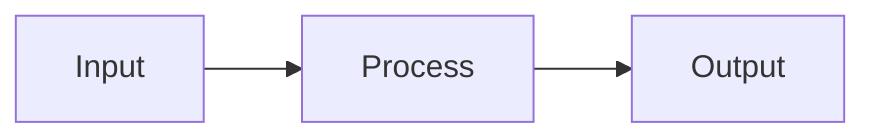

# {{title}}

> **TL;DR** — One or two sentences. If you cannot write this, the note is not ready.

## Why it matters

Where this idea shows up in real systems, and what breaks if you ignore it.

## Core ideas

- Idea one, stated plainly.
- Idea two.

## Diagram

## Key equations

$$
y = f(x)
$$

State what every symbol means, with units.

## Worked example

A small, concrete, checkable example (numbers or runnable code).

## Pitfalls

- The mistake people actually make.

## Related

- [Topic hub](index.md) — replace with links to the specific related notes

## Further reading

- Author, *Title* — why it is worth reading.
